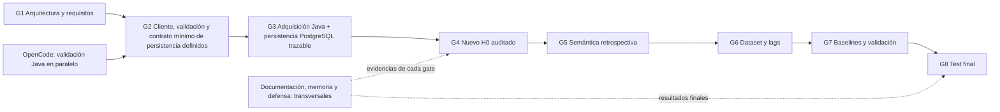

# Plan y backlog de Glea-Weather

Plan de hitos relativos y punto de entrada operativo para el backlog. No es una promesa de fecha, dedicación o avance. Las tareas T1–T9 existentes se sincronizan con Jira; este documento y la guía conservan el contexto, las decisiones y las evidencias necesarias para interpretarlas. La guía contiene el detalle: [Guía de desarrollo](GLEA-WEATHER-DEVELOPMENT-GUIDE.md). La copia [Plan revisado](GLEA-WEATHER-PLAN-REVISADO.md) se mantiene alineada con este punto de entrada, no como una versión alternativa.

## Estado y alcance

| Estado | Trabajo | Evidencia / límite |
|---|---|---|
| **REALIZADO (reportado)** | H0 exploratorio H0-01…H0-06, cierre `GREEN_WITH_CAVEATS` | Trabajo completado por el responsable; el dossier primario no fue localizado en el subárbol revisado por Work, por lo que sus cifras no se recotejaron aquí. No atribuir este trabajo a Java. |
| **ACTUAL — paralelo** | Consolidación del cliente Java y validaciones de integración mediante TDD a cargo del trabajo concurrente OpenCode | Referencia al trabajo existente `weather/odd/tasks/aemet-integration-validation.md`; no duplicar tickets por clases/tests ni interferir con `weather/**`. Resultados aún no verificados en esta planificación. |
| **ACTUAL — documentación** | Revisar arquitectura, requisitos, fases y plan | Esta guía y este plan organizan trabajo futuro; no implementan sistema. |
| **POSTERIOR** | Adquisición reproducible con Java, nuevo H0 independiente, preparación científica y evaluación | Sujeto a gates y evidencia de cada etapa; recuperación del dossier exploratorio recomendada, no bloqueo. |

**Decisión vigente (consulta comunicada por el responsable, 2026-10-18):** Java/Spring Boot para adquisición y Python para preparación/modelado. El responsable informa que el tutor acepta adaptar tecnologías mientras se mantenga el fin del proyecto. La decisión no modifica ni atribuye aprobación al PDF académico. La evolución será mínima y guiada por necesidades concretas. Variables futuras como humedad son admisibles en principio, pero no se añaden al experimento actual; cualquier ampliación requiere justificación y un diseño comparable.

**Decisión RF-02/RF-03 (2026-10-18):** se aprueba el diseño de validación HTTP/JSON/esquema/estación y la dirección Spring Boot–PostgreSQL como práctica formativa acotada, sin alegar necesidad de Big Data ni rendimiento supuesto. Las respuestas fuente se preservan en bytes inmutables con manifiesto/run/hash; PostgreSQL aporta persistencia técnica consultable trazada al original y a la ejecución. CSV queda como exportación/intercambio opcional; Spark se difiere. El contrato mínimo de esquema/carga, reintentos y fallos sigue pendiente de G2. No implica código, conexión ni adquisición ya ejecutados.

**Revisión de diseño del responsable (2026-10-18):** RF-01–RF-10, RNF-01–RNF-04 y RM-01–RM-10 quedan aceptados a nivel de diseño. La documentación de responsabilidades, límites de contrato, requisitos, discrepancia Java/Python y pendientes asignados cierra T1 y el alcance documental de G1. Implementación y evidencia de cumplimiento siguen pendientes; también siguen pendientes el contrato técnico de G2 y la evidencia física AEMET de G5.

**Estado AD-T2 (2026-10-19):** AD-T2-01–19 son decisiones aprobadas de diseño; las referencias 20–22 se retiraron como propuestas independientes y su contenido esencial se integró en el contrato/matriz y la verificación pendiente de G2, sin aprobación arquitectónica en bloque. La regla retrospectiva `[start, end)` con `feature.end <= origin_cutoff <= target.start` está decidida, pero la semántica física AEMET por variable y zona sigue pendiente en G5. Véase el [mapa y la integración AD-T2](GLEA-WEATHER-DEVELOPMENT-GUIDE.md#ad-t2-decision-map). Enmienda aprobada (2026-10-19): la cobertura inicial se deriva de fechas verificables, no se guardan columnas redundantes; desconocido no equivale a cero y la consulta se concreta en G2.

## Cronograma por hitos (Gantt relativo, sin fechas inventadas)

No se ha fijado aquí una fecha de entrega, dedicación semanal ni duración verificadas. **Este es un mapa de fases y dependencias**, no un Gantt calendarizado: al confirmar calendario y capacidad se podrá traducir a Mermaid `gantt` con fechas reales, sin utilizar anclas ficticias.

| Línea de trabajo | Realizado | Actual: G1/G2 | Tras G2: G3/G4 | Tras G4: G5/G6 | Tras G6: G7/G8 |
|---|:---:|:---:|:---:|:---:|:---:|
| H0 exploratorio | ✓ | | | | |
| Cliente Java y validaciones (OpenCode) | | ● | | | |
| Arquitectura, requisitos y backlog | | ● | revisión | | |
| Adquisición Java y nuevo H0 | | | ● | | |
| Semántica temporal, curado y features | | investigación | investigación | ● | |
| Baselines, experimentos y evaluación | | | | | ● |
| Registro de evidencias y documentación técnica | ● | ● | ● | ● | ● |
| Memoria y preparación de defensa | | ● | ● | ● | ● / cierre final |

`✓`: trabajo exploratorio realizado según el responsable; `●`: fase de trabajo planificada, **no afirmación de progreso**. La memoria recopila decisiones/evidencias durante todo el ciclo; conclusiones, figuras definitivas y defensa final dependen del test y de resultados verificados.

El diagrama expresa dependencias, no una programación ejecutada ni el estado verificado del trabajo de OpenCode. La investigación semántica y la documentación pueden avanzar en paralelo, pero ninguna feature se admite sin superar su gate.

**Lectura:** G2 depende de G1 y de la revisión de integración concurrente, e incluye definir el contrato mínimo de carga/consulta/repetición/fallos; G3–G4 requieren acceso legítimo a la API y protección de secretos. G3 preservará los originales aunque falle PostgreSQL y no afirmará atomicidad entre ambos medios sin mecanismo. G5 exige semántica física y corte causal retrospectivo para las features utilizadas (precipitación 07–07 en particular); G6 precede al entrenamiento y G8 solo se abre después del freeze. Si una dependencia se retrasa, no se rebaja su criterio. Documentación y preparación de defensa acompañan cada gate.

## Flujo propuesto

Para una sola persona: `Pendiente → En curso → En revisión → Hecho`, con `Bloqueado` como estado visible cuando una fuente, decisión o gate impide avanzar. Evitar estados de sub-tarea por método/test; mantener las evidencias en archivos de salida y enlazarlas desde el ticket. Solo la persona responsable decide mover a `Hecho` cuando el criterio de aceptación está demostrado.

## Épicas y tareas propuestas

Los IDs `E` y `T` son locales a este plan, no identificadores de Jira; las tareas T1–T9 existentes se mantienen, sin crear tickets por tecnología.

### E1 — Alcance, arquitectura y requisitos

#### T1 — Aprobar límites y requisitos del proyecto

- **Objetivo:** revisar límites Java/Python, requisitos funcionales RF-01–RF-10 y alcance científico; registrar los diseños aceptados y mantener abiertos los detalles de contrato y decisiones científicas no resueltas.
- **Alcance:** revisar guía, requisitos RF/RNF/RM y discrepancia entre propuesta PDF y decisión actual; no tocar código.
- **Aceptación:** cada requisito conserva estado/origen/criterio/evidencia; RF-01–RF-10, RNF-01–RNF-04 y RM-01–RM-10 tienen diseño aprobado con implementación/evidencia pendientes; la dirección Spring Boot–PostgreSQL queda justificada como práctica, no como necesidad de escala. G1 se cierra en su alcance documental: responsabilidades, límites de contrato, requisitos, discrepancia tecnológica y pendientes asignados a gates posteriores están documentados. La convención matemática `[start, end)` con `feature.end <= origin_cutoff <= target.start` queda decidida, mientras la evidencia física AEMET sigue pendiente en G5.
- **Evidencia:** decisión del responsable, guía revisada y consulta al tutor reportada por el responsable; no se afirma verificación independiente ni modificación del PDF.
- **Dependencias:** ninguna.
- **Requisitos relacionados:** RNF-02, RF-01, RF-06, RM-01.
- **Estado:** Cerrado (revisión documental); G1 no acredita implementación ni cierra gates técnicos.

### E2 — Integración y adquisición Java

#### T2 — Cerrar la integración de cliente antes de adquirir series

- **Objetivo:** cerrar el trabajo de integración actual y distinguir el inventario probado de la adquisición de observaciones.
- **Alcance:** continuar el ticket/trabajo existente `weather/odd/tasks/aemet-integration-validation.md`; no crear tickets repetidos de tests, ni cambiar `weather/**` en esta tarea documental.
- **Aceptación:** evidencia real de validación HTTP/JSON/esquema/estación disponible y contrato mínimo propuesto para origen inmutable más PostgreSQL técnico (carga, consulta/linaje, misma-run repetida frente a nueva adquisición, fallos/incompletitud); no se etiqueta inventario como corpus diario ni se impone ORM/esquema antes de G2.
- **Evidencia:** resultado verificable de integración y revisión técnica de `weather/docs/AEMET-INTEGRATION.md` cuando el trabajo concurrente esté cerrado.
- **Dependencias:** definición documental de límites (T1) y trabajo OpenCode paralelo; respuesta del tutor no es un bloqueo normativo acreditado.
- **Requisitos relacionados:** RF-01, RF-02, RNF-01.
- **Estado propuesto:** En curso fuera de este plan; confirmar estado al retomar.

#### T3 — Adquirir serie meteorológica con ejecución identificable

- **Objetivo:** obtener una serie real de la estación seleccionada a través de Java, dejando claro qué se pidió y qué llegó.
- **Alcance:** adquisición futura de `7211B`, periodo aprobado, manejo de fallos/parciales, archivos originales, manifiesto, redacción de credenciales y destinos únicos.
- **Aceptación:** run real completado; estación y periodo observado confirmados; bytes originales preservados; registros técnicos consultables y trazados a fuente/run; hash comprobable; recargar el mismo run no duplica accidentalmente, una nueva adquisición tiene identidad nueva; parcial/error no se presenta como conjunto completo; original permanece recuperable si falla la BD; sin API key en datos/logs.
- **Evidencia:** originales, manifiesto/run v1 aprobado, registro saneado de ejecución, comprobación independiente de hashes y consulta/linaje en PostgreSQL. No exigir atomicidad filesystem–BD sin mecanismo aprobado.
- **Dependencias:** T1, T2, acceso legítimo/credenciales y G2 técnico; no depende de repetir la consulta tecnológica ya reportada.
- **Requisitos relacionados:** RF-01–RF-04, RNF-01, RNF-03.
- **Estado propuesto:** Pendiente.

### E3 — Evidencia de datos y H0 reproducible

#### T4 — Auditar y reconciliar la adquisición nueva

- **Objetivo:** determinar independientemente la calidad, cobertura y discrepancias internas del nuevo corpus; comparar con el H0 exploratorio solo si se recupera evidencia suficiente.
- **Alcance:** auditoría versionada en Python; comparar con corpus exploratorio solo si los originales/manifiestos primarios se recuperan.
- **Aceptación:** producir conteos por variable/estado, calendario, duplicados, rango real y errores de parseo del corpus nuevo; etiquetar fuente/periodo; no alterar RAW. La comparación con históricos es opcional y no bloquea G4.
- **Evidencia:** informe reproducible, configuración, logs saneados y referencias a archivos con hashes.
- **Dependencias:** T3; recuperación de evidencias exploratorias solo si se desea efectuar comparación histórica.
- **Requisitos relacionados:** RF-03–RF-06, RNF-03, RM-09, RM-10.
- **Estado propuesto:** Pendiente.

### E4 — Semántica y dataset científico

#### T5 — Resolver semántica y corte retrospectivo de predictores

- **Objetivo:** justificar por variable etiqueta, intervalo físico y zona para aplicar la convención `[start, end)` y `feature.end <= origin_cutoff <= target.start` retrospectivo.
- **Alcance:** incluir Tmin, Tmed/Tmax candidatas y precipitación 07–07; distinguir intervalo medido de publicación AEMET, sin exigir disponibilidad operativa para el TFC retrospectivo. Consultar al tutor si se propone alterar el objetivo científico.
- **Aceptación:** evidencia física por variable que permita aplicar la regla decidida `feature.end <= origin_cutoff <= target.start`; igualdad está permitida. Si faltan límites/zona confiables, bloquear la feature afectada. Ninguna conclusión retrospectiva se presenta como operación real.
- **Evidencia:** fuentes con fecha/versión, registro de decisión y tabla de etiqueta, intervalo/zona y `origin_cutoff`; `available_at` real solo para extensión operativa.
- **Dependencias:** T1 y T4.
- **Requisitos relacionados:** RM-02, RM-03.
- **Estado propuesto:** Pendiente; bloquea M2 mientras no se resuelva precipitación 07–07.

#### T6 — Construir dataset versionado y máscaras comparables

- **Objetivo:** formar targets, lags de calendario y manifests por target sin fuga temporal.
- **Alcance:** transformaciones Python separadas del original; política de especiales/missing; split candidato por `target_date`; fechas comunes M1/M2.
- **Aceptación:** lags solo consultan fechas exactas; targets Tmin/Tmax son t+1; dataset sigue protocolo aprobado; train/valid/test sin solapamiento; pairing exacto por target/split; cada rechazo tiene motivo.
- **Evidencia:** esquema/versión, manifests, conteos y casos de frontera documentados.
- **Dependencias:** T4, T5 y G5.
- **Requisitos relacionados:** RF-06, RF-07, RF-09, RM-01–RM-04, RM-06, RM-09.
- **Estado propuesto:** Pendiente.

### E5 — Experimento y evaluación

#### T7 — Ejecutar baseline y selección en train/validación

- **Objetivo:** medir referencias y comparar M1/M2 con criterio y presupuesto predeclarados.
- **Alcance:** baseline M0 causal por target; modelos sencillos justificados; MAE primaria y RMSE complementaria; cada target se reporta por separado.
- **Aceptación:** artefactos y configuraciones reproducibles; M1/M2 usan la misma población/protocolo; test no se usa en ajuste, selección, preprocessing ni elección de features.
- **Evidencia:** predicciones y métricas de train/validation, conteos, presupuesto y log de decisiones/fallos.
- **Dependencias:** T6 y G6.
- **Requisitos relacionados:** RF-08–RF-10, RM-04–RM-08.
- **Estado propuesto:** Pendiente.

#### T8 — Congelar protocolo y evaluar el test final una vez

- **Objetivo:** estimar desempeño independiente y comunicar límites sin volver a seleccionar con el holdout.
- **Alcance:** abrir el test candidato solo tras freeze aprobado; evaluar por target/setup, informar pares, cobertura y discrepancias.
- **Aceptación:** protocolo/configuración fechados antes de predicciones; resultado completo o fallo documentado; ningún retuning posterior en el mismo test.
- **Evidencia:** manifiesto de freeze, resultados, limitaciones, hashes y reproducción o explicación de variabilidad.
- **Dependencias:** T7 y G7.
- **Requisitos relacionados:** RM-05, RM-08, RM-10, RF-10.
- **Estado propuesto:** Pendiente.

### E6 — Comunicación y memoria académica

#### T9 — Documentar durante todo el ciclo y preparar memoria/defensa

- **Objetivo:** registrar decisiones y evidencias desde G1 y preparar progresivamente material de estudio, memoria y defensa; sin escribir una memoria académica en nombre del alumno.
- **Alcance:** desde G1 documentar arquitectura, alternativas, riesgos y pruebas de adquisición; durante G3–G7 agregar evidencia científica y bosquejos de defensa; solo tras G8 cerrar conclusiones, métricas y figuras definitivas. Elegir herramienta de visualización si existe necesidad; no construir app ni infraestructura.
- **Aceptación:** documentación técnica incremental tras cada gate con vínculos requisito–decisión–evidencia; versión final, figuras y defensa revisadas después del test, con alcance retrospectivo y límites claros; nunca afirmar mejora sin respaldo.
- **Evidencia:** notas técnicas y registro de decisiones por gate; posteriormente informe, visualizaciones reproducibles y material de defensa revisado por el responsable.
- **Dependencias:** inicio con G1; alimentada por G2–G8; cierre final después de T8.
- **Requisitos relacionados:** RNF-03, RM-08, RM-10.
- **Estado propuesto:** Transversal desde G1; cierre final pendiente de T8.

## Trazabilidad resumida

| Requisitos | Decisión de arquitectura/método | Tarea | Gate | Evidencia de cierre |
|---|---|---|---|---|
| RF-01, RF-02, RNF-01 | Java adquiere y valida HTTP/JSON/esquema/estación; respuesta inválida no produce corpus completo; credencial no se persiste | T2, T3 | G2, G3 | Casos de validación y ejecución real documentados |
| RF-03, RF-04, RNF-03 | Bytes RAW inmutables + manifiesto/hash y persistencia técnica PostgreSQL trazada a fuente/run; CSV opcional | T2, T3, T4 | G2–G4 | Original recuperable, run/manifiesto y consulta/linaje/auditoría |
| RF-05, RF-06, RNF-02 | Python tipa y transforma; no reescribe RAW | T4, T6 | G4, G6 | Informe de calidad y salidas versionadas |
| RM-01, RM-02, RM-03 | Tmin/Tmax del día siguiente; lags por fecha; intervalo observado que termina como máximo en el corte retrospectivo | T5, T6 | G5, G6 | Fuente primaria, tabla temporal y manifests |
| RF-07, RM-04, RM-06, RM-07, RM-09 | Targets por fecha target, mismas claves, transform fit solo train | T6, T7 | G6, G7 | Manifiestos sin solapamiento y pairing |
| RF-08, RF-09, RM-05, RM-08 | Baseline, M1/M2 emparejados, test final protegido | T7, T8 | G7, G8 | Predicciones, métricas y freeze |
| RF-10, RM-10 | Linaje desde adquisición hasta resultado | T3–T9 | G3–G8 | Reproducción trazable y comunicación |

## Próximo paso

T1/G1 documental está cerrado y los diseños aceptados no deben reabrirse ni presentarse como implementación o cumplimiento verificado. El siguiente hito es T2/G2: dejar finalizar a OpenCode su alcance Java sin duplicarlo y revisar, concretar e implementar únicamente el contrato técnico mínimo aprobado, con pruebas/evidencia antes de cerrar el gate. Después, con acceso legítimo a la API, realizar adquisición identificable (G3) y auditar el corpus nuevo (G4). No usar precipitación 07–07 ni iniciar M2 hasta resolver la semántica física por variable y el corte retrospectivo (G5). Registrar evidencias para la memoria desde ahora.

