# Guía de desarrollo experimental de Glea-Weather

Esta guía prepara la siguiente etapa del TFC sin ejecutar análisis, modificar datos ni entrenar modelos. Su propósito es que una persona pueda comprender la evidencia disponible, tomar las decisiones que siguen abiertas y, solo después de superarlas, implementar y evaluar un experimento temporal reproducible.

> **Estado:** documento de planificación. No acredita que la preparación, el modelado, la validación ni la evaluación final se hayan realizado.

## Tabla de contenidos

1. [Cómo leer esta guía](#1-cómo-leer-esta-guía)
2. [Estado de partida](#2-estado-de-partida)
3. [Pregunta experimental](#3-pregunta-experimental)
4. [Decisiones vigentes y decisiones abiertas](#4-decisiones-vigentes-y-decisiones-abiertas)
5. [Arquitectura propuesta](#5-arquitectura-propuesta)
6. [Casos de uso](#6-casos-de-uso)
7. [Diagramas de flujo y dependencias](#7-diagramas-de-flujo-y-dependencias)
8. [Contratos de datos y experimentos](#8-contratos-de-datos-y-experimentos)
9. [Fase 1 — Análisis y preparación conceptual](#9-fase-1--análisis-y-preparación-conceptual)
10. [Fase 2 — Estrategia experimental](#10-fase-2--estrategia-experimental)
11. [Fase 3 — Optimización del proceso y del modelo](#11-fase-3--optimización-del-proceso-y-del-modelo)
12. [Fase 4 — Validación y comunicación](#12-fase-4--validación-y-comunicación)
13. [Estrategia de modelado](#13-estrategia-de-modelado)
14. [Diseño experimental M1 frente a M2](#14-diseño-experimental-m1-frente-a-m2)
15. [Gestión de riesgos](#15-gestión-de-riesgos)
16. [Gates de decisión y criterios de salida](#16-gates-de-decisión-y-criterios-de-salida)
17. [Checklist humano de ejecución](#17-checklist-humano-de-ejecución)
18. [Qué no hacer](#18-qué-no-hacer)
19. [Próximo paso](#19-próximo-paso)
20. [Fuentes y vocabulario](#20-fuentes-y-vocabulario)

---

## 1. Cómo leer esta guía

La etiqueta al inicio de cada afirmación separa el estado de una decisión de la calidad de la evidencia que la respalda:

| Etiqueta | Significado en esta guía |
|---|---|
| **VERIFICADO** | Observado directamente en el repositorio o respaldado por una fuente primaria disponible y revisada. |
| **DECIDIDO** | Dirección explícita vigente del responsable; puede requerir consulta académica o evidencia para su cierre (consulta no equivale a autorización obligatoria). |
| **PROPUESTO** | Diseño recomendado pendiente de aceptación. |
| **PENDIENTE** | Dato, decisión o comprobación aún no disponible; no se resuelve por intuición ni mirando el test. |
| **HISTÓRICO** | Resultado anterior reportado o conservado cuya fuente primaria no pudo cotejarse en esta revisión. El trabajo puede estar realizado sin que Work haya podido verificar aquí todos sus artefactos. |

Las decisiones metodológicas importantes usan siempre siete preguntas. La primera puede describir un hecho congelado o una propuesta; esa condición se indica en su título.

> **DECISIÓN** — Qué se adopta o qué se propone adoptar.
> **MOTIVO** — Qué problema resuelve o qué evidencia la sustenta.
> **ALTERNATIVAS** — Opciones reales consideradas.
> **VENTAJAS** — Beneficios de la opción elegida.
> **INCONVENIENTES** — Costes o capacidades que se pierden.
> **RIESGOS** — Qué puede salir mal y cómo se detectaría.
> **CRITERIO DE ELECCIÓN** — Evidencia que permite aceptarla o cambiarla.

### Ruta de lectura

1. Leer primero las secciones 2–4 para distinguir qué está probado y qué sigue abierto.
2. Usar las secciones 5–8 para entender qué artefactos y límites debería respetar una implementación futura.
3. Seguir las fases 9–12 en orden: semántica y disponibilidad antes de ajustar modelos.
4. Revisar justicia comparativa, riesgos y gates antes de abrir el conjunto final.
5. Ejecutar la checklist solo cuando el responsable del proyecto autorice la fase correspondiente.

---

## 2. Estado de partida

### 2.1 Evidencia histórica y estado actual

**VERIFICADO — subárbol inspeccionado por Work:** existe esta guía y un módulo `weather` con `AemetRunner`, configuración `RestClient`, documentación de integración y pruebas. Work no localizó en ese subárbol el directorio `H0-DATA/` citado por versiones anteriores; esto **no demuestra** que el dossier no exista en otro lugar. El `AemetRunner` observado es un inventario/ejercicio de integración; no acredita por sí solo la descarga de una serie diaria.

**REALIZADO según el responsable — H0 exploratorio:** se completaron H0-01…H0-06 y se cerraron como `GREEN_WITH_CAVEATS` para evaluar la viabilidad. La guía anterior registró para `7211B` Puerto Lumbreras 2010–2025 un corpus de 5.844 días, conteos Tmin 5.831, Tmed 5.830, Tmax 5.833 y precipitación numérica 5.684, y una sobrescritura de salidas H0-03 durante un análisis fallback. **Las cifras no han sido cotejadas aquí contra los artefactos primarios.** El H0 reproducible mediante adquisición Java es una fase nueva y pendiente, no una repetición declarada como ya ejecutada.

Los seis informes exploratorios constituyen **trabajo realizado y comunicado por el responsable**, aunque sus artefactos primarios no estaban accesibles en el subárbol revisado por Work. Recuperarlos permite comparación histórica y verificación independiente; **no es condición obligatoria** para adquirir un corpus nuevo con Java ni para auditarlo de forma autónoma. En el [registro histórico y pendientes](#registro-histórico-y-pendientes-de-evidencia) se identifican las comprobaciones recomendadas, sin simular una reejecución.

### 2.2 Precipitación y otras variables

**HISTÓRICO — informe H0-02 citado por la guía, sin fuente primaria disponible:** se reportaron 4.883 ceros numéricos, 801 valores numéricos no cero, 159 ausencias y un valor `Acum` en 2017-01-18 dentro de 5.844 registros. La guía anterior describía conservar el token original y tratarlo como especial, no como cero. Estas cifras y reglas deben cotejarse con evidencia recuperada o con una nueva adquisición; aquí no se ejecutó auditoría.

**HISTÓRICO — metadatos consultados durante H0 exploratorio, no recotejados en esta revisión:** precipitación diaria «de 07 a 07», `Ip` inferior a 0,1 mm y `Acum` acumulada; según el responsable, `Ip` no apareció en aquel corpus. **PENDIENTE:** cotejar la fuente AEMET aplicable y resolver la alineación temporal antes de usar precipitación como feature.

**PENDIENTE CRÍTICO:** no está resuelta la correspondencia exacta entre la etiqueta de precipitación, su intervalo físico 07–07, la zona horaria y el corte temporal retrospectivo de predicción. Antes de crear sus features debe acreditarse que las mediciones incluidas terminan antes del corte elegido. La hora real de publicación de AEMET se exige solo si posteriormente se pretende evaluar operación en tiempo real.

**H0 EXPLORATORIO REALIZADO (no recotejado aquí):** H0-06 reportó alta cobertura de humedad y dejó fuera del experimento principal humedad, `pintMax` y variables horarias. Esa decisión de alcance se mantiene sin atribuir la cobertura al corpus nuevo.

### 2.3 Cobertura, retardos y estaciones

**H0 EXPLORATORIO REALIZADO (no recotejado aquí):** H0-04 examinó ventanas de 1, 3, 7 y 14 días y su cobertura. La factibilidad previa no elige una ventana predictiva ni garantiza cobertura tras la nueva adquisición, la resolución semántica o cambios de máscara.

**H0 EXPLORATORIO REALIZADO (no recotejado aquí):** H0-05 documentó diferencias de cobertura en Lorca `7209` y Totana `7218Y`. Esas cifras no se convierten en evidencia del nuevo corpus; la estación principal sigue siendo `7211B` Puerto Lumbreras, con identidad a confirmar en la nueva adquisición. No se mezclan estaciones para rellenar huecos.

### 2.4 Lo que este estado permite y no permite afirmar

- **Permite:** planificar preparación trazable y un experimento temporal con dos configuraciones de variables.
- **No permite:** afirmar que algún modelo mejora una referencia, pronosticar un error esperado o seleccionar una ventana por calidad predictiva.
- **No permite:** usar la validación histórica de H0 como predicción de retención tras resolver la semántica.
- **No permite:** atribuir los archivos actuales de H0-03 a `7211B` solo porque exista un hash anterior.
- **No permite:** modificar RAW ni convertir una auditoría de calidad en entrenamiento.

---

## 3. Pregunta experimental

### 3.1 Pregunta central

**INFERENCIA / PROPUESTA:** para cada origen de predicción diario admisible en `7211B`, ¿añadir historia de precipitación disponible en ese origen reduce el error de predicción de Tmin o Tmax del día natural siguiente frente a un modelo con la misma historia térmica, al comparar ambos con las mismas fechas, targets, familias de modelos, particiones, métricas y presupuesto de ajuste?

La unidad de observación es:

```text
(station_id, forecast_origin_date)
```

Cada unidad tiene un objetivo separado por variable:

```text
target_date = forecast_origin_date + 1 día natural
target_Tmin = Tmin(target_date)
target_Tmax = Tmax(target_date)
```

La fecha de target determina el bloque train/validation/test. El origen indica la fecha a la que se refiere la información histórica. La distinción evita etiquetar como entrenamiento una observación por su fecha de origen cuando su target cae en un bloque posterior.

### 3.2 Relojes del dato y alcance retrospectivo

El TFC actual es **un experimento retrospectivo D+1**, no un servicio de pronóstico en producción. Para cada predictor hay que distinguir:

1. **Fecha de etiqueta del registro:** día que AEMET asocia a la observación.
2. **Intervalo observado:** comienzo y fin físicos de la magnitud (con zona horaria).
3. **`origin_cutoff` / `issue_at` conceptual:** corte temporal declarado para construir la muestra retrospectiva; **no demuestra** que un producto histórico de AEMET se publicara en ese instante.
4. **`available_at` de publicación:** fecha/hora real de disponibilidad para un consumidor de la API; **opcional y pendiente** mientras no se pretenda sostener un pronóstico operativo.

**Regla principal retrospectiva:** un predictor es admisible solo si su **intervalo observado termina como máximo en `origin_cutoff`** y su etiqueta/lag se ha alineado correctamente. No basta con que la fecha registrada sea `t`: las mínimas y máximas completas de `t` no estaban observadas al comienzo de ese día. Debe definirse un corte posterior a la finalización de las medidas incluidas, sin usar ninguna del target `t+1`.

**Regla adicional si se propusiera operación real:** también habría que demostrar `available_at <= issue_at` de emisión efectiva y considerar el retraso de publicación AEMET. Esa prueba **no es un requisito previo del experimento retrospectivo**. Si el intervalo físico o etiqueta de una variable (especialmente `prec` 07–07) no puede justificarse, la feature afectada sigue bloqueada hasta resolver su causalidad. No cambiar el target ni llamar pronóstico operativo a una evaluación retrospectiva.

### 3.3 Definiciones candidatas de historia

Una ventana de longitud `L` puede significar dos cosas diferentes:

```text
lags {0, ..., L-1}: incluye el día del origen
lags {1, ..., L}: excluye el día del origen
```

Aquí `lag k` significa el valor etiquetado para `forecast_origin_date - k días`. No asumir que ambas convenciones son equivalentes. Seleccionar una tras la revisión de disponibilidad de cada variable, anotarla en el contrato de features y mantenerla idéntica en M1 y M2 para las columnas compartidas.

Las columnas térmicas candidatas son Tmin, Tmed y Tmax disponibles de forma numérica, pero la inclusión exacta de cada variable y lag debe congelarse antes del primer ajuste. Tmed no es obligatoria por llamarse «media», ni se permite elegir columnas tras observar resultados del test.

### 3.4 Preguntas secundarias y alcance

- ¿Qué ventana de calendario (`1`, `3`, `7`, `14`) ofrece un equilibrio aceptable entre señal y cobertura usando train/validation?
- ¿La aportación observada de M2 es consistente para Tmin y Tmax o específica de un target?
- ¿El comportamiento cambia por año o por disponibilidad de precipitación?
- ¿La conclusión es estable frente a pequeñas diferencias de rendimiento y a errores diarios temporalmente dependientes?

Estas preguntas no se contestan con la cobertura sola. Describir diferencias por periodos o días secos/húmedos es análisis descriptivo; no convierte automáticamente un subconjunto en objetivo de selección.

---

## 4. Decisiones vigentes y decisiones abiertas

### 4.1 Alcance explícito actual y protocolo científico propuesto

La propuesta académica PDF define Tmin y Tmax del día siguiente y compara temperatura con temperatura más precipitación; menciona Python también para adquisición. La decisión vigente del responsable es **Java/Spring Boot para adquirir/validar originales y metadatos, Python para ciencia y modelado**. El responsable informa que consultó al tutor y que no hay inconveniente en adaptar o incorporar tecnologías mientras se mantenga el fin del proyecto; esta conformidad reportada respalda la elección tecnológica, pero no modifica la propuesta PDF ni acredita ejecución. La evolución será guiada por necesidades concretas y sin sobreingeniería. No se afirma que el Java actual ya descargue series.

| Aspecto | Estado actual | Evidencia o cierre que falta |
|---|---|---|
| Targets | **DECIDIDO:** Tmin(t+1) y Tmax(t+1); no reemplazar por Tmed | Mantener en protocolo, contratos y resultados por target |
| Estación principal | **DECIDIDO:** `7211B` Puerto Lumbreras | **PENDIENTE:** confirmación de identidad en adquisición reproducible |
| Pregunta M1/M2 | **DECIDIDO:** historia térmica frente a la misma historia térmica + precipitación | **PENDIENTE:** semántica y disponibilidad de precipitación |
| Adquisición | **DECIDIDO:** responsabilidad Java/Spring Boot, con conformidad tecnológica reportada por el responsable tras consultar al tutor | **PENDIENTE:** ejecución real y comprobación de rango/respuesta |
| Persistencia técnica | **DECIDIDO (2026-10-18):** integrar Spring Boot con PostgreSQL como práctica acotada; conservar aparte los bytes originales y su manifiesto | **PENDIENTE:** contrato mínimo de carga, trazabilidad, repetición y fallos para G2; no implica esquema/JPA/ORM decidido |
| Ciencia | **DECIDIDO:** Python prepara semántica, features, splits, modelos y evaluación | **PROPUESTO:** contrato de archivos versionado en §8.8 |
| Lags | **PROPUESTO:** fechas naturales exactas, nunca fila anterior | Evidencia de fecha/intervalo y disponibilidad por predictor |
| Ventanas iniciales | **HISTÓRICO:** 1, 3, 7 y 14 días aparecían en auditoría anterior | **PENDIENTE:** confirmar que siguen siendo candidatos útiles antes de seleccionar |
| Partición candidata | **PROPUESTO, pendiente de reproducir y aprobar:** train 2010–2019, validación 2020–2023, test 2024–2025 por `target_date` | Comprobar corpus, tamaños y frontera; no cambiarla unilateralmente |
| Métricas | **PROPUESTO:** MAE principal, RMSE complementaria, ambas por target | Aprobar protocolo antes de modelar |
| Emparejamiento | **PROPUESTO:** fechas comunes válidas por target y split para la comparación principal M1/M2 | Manifiestos de claves idénticas |
| RAW y especiales | **DECIDIDO en dirección:** bytes originales inmutables y estados distinguibles; PostgreSQL técnico enlazado a fuente/run | Contrato mínimo de almacenamiento/carga/consulta y evidencia pendientes de G2 |
| Variables adicionales | **DECIDIDO:** no incorporarlas al experimento principal actual | El responsable informa que el tutor acepta en principio incorporarlas a futuro; cada cambio de objetivo o variable requiere revisión de alcance, justificación y diseño experimental comparable. No se incorpora humedad ahora |

**Nota de decisión (2026-10-18, consulta comunicada por el responsable):** se acepta adaptar tecnologías a las necesidades encontradas si se conserva el fin académico, sin sobreingeniería; RF-01 queda decidido con Java/Spring Boot para adquisición y validación, RF-02 con validación estricta de HTTP/JSON/esquema/estación, y RF-03 con originales inmutables más persistencia técnica consultable en PostgreSQL, trazable a fuente y run. La motivación de PostgreSQL es práctica formativa de integración, no una necesidad de Big Data ni un rendimiento supuesto. Spark se difiere a un incremento futuro. Python conserva la interpretación científica. Esta aceptación de diseño no aprueba el contrato detallado de carga ni acredita implementación, prueba de serie, base de datos operativa o evidencia de ejecución; el detalle mínimo sigue pendiente en G2. El responsable también comunica que futuras variables como humedad son admisibles en principio, pero no forman parte del experimento actual y no se presume una mejora. Esta nota registra el informe del responsable, no una verificación independiente ni una modificación/aprobación del PDF académico.

La propuesta temporal preliminar se asigna por `target_date`, no por origen. Así, el origen 2019-12-31 con target 2020-01-01 pertenecería al bloque de validación si el protocolo se aprueba; el origen 2023-12-31 con target 2024-01-01 pertenecería al test. Esta regla y sus fechas reales son propuestas a verificar con el corpus reproducido, no una configuración ya ejecutada.

### 4.2 Decisiones que siguen abiertas

| Decisión | Evidencia/criterio requerido | Estado antes del análisis |
|---|---|---|
| Relación fecha–intervalo 07–07 y zona horaria | Fuente AEMET autoritativa aplicable a estos registros | **PENDIENTE; bloquea features de precipitación** |
| Corte temporal retrospectivo | Corte posterior al fin físico de las observaciones y anterior al target; distinguirlo de publicación real | **PENDIENTE** |
| Lags que incluyen `t` o empiezan en `t-1` | Fin del intervalo observado frente a `origin_cutoff` | **PENDIENTE** |
| Columnas térmicas exactas | Contrato escrito antes del ajuste | **PENDIENTE** |
| Política de filas sin target | Decidir dataset por target o pares completos | **PENDIENTE** |
| Política futura para `Ip` | Reglas de fuente y análisis de sensibilidad | **PENDIENTE; no aparece en el corpus auditado** |
| Ventana final | Rendimiento y cobertura de train/validation con fechas comparables | **PENDIENTE** |
| Familia no lineal inicial | Una hipótesis, coste y criterios previos | **PENDIENTE** |
| Umbral de relevancia práctica | Definido antes de abrir resultados de selección | **PENDIENTE** |
| Regla de incompatibilidad Tmin > Tmax predicha | Reportar, descartar o tratar; no corregir sin protocolo | **PENDIENTE** |

### 4.3 Decisión metodológica: congelar el protocolo antes del ajuste

**DECISIÓN — propuesta:** convertir las decisiones abiertas en un protocolo versionado antes de comparar modelos.

**MOTIVO:** elegir lags, máscaras o columnas después de ver qué resultado luce mejor convierte la validación en parte del entrenamiento de decisiones.

**ALTERNATIVAS:** dejar que cada notebook decida sobre la marcha; o fijar un protocolo breve en metadatos de experimento antes del ajuste.

**VENTAJAS:** reduce ambigüedad, permite reproducción y hace visible qué cambió entre corridas.

**INCONVENIENTES:** exige resolver preguntas que parecen cómodas de posponer y puede requerir una nueva versión del protocolo si aparece evidencia semántica relevante.

**RIESGOS:** una regla congelada pero mal justificada puede ser reproducible y aun así medir lo incorrecto.

**CRITERIO DE ELECCIÓN:** protocolo revisado por una persona responsable, cada incógnita con evidencia/decisión, y cambios posteriores documentados antes de consultar el test final.

### 4.4 Registro de decisiones metodológicas centrales

Los siguientes registros hacen explícitos los tradeoffs que condicionan todo el experimento. Se mantienen como propuestas hasta que la persona responsable aporte evidencia y aprobación.

#### Origen temporal y elegibilidad de features — propuesta bloqueada

- **DECISIÓN:** fijar un `origin_cutoff` retrospectivo y comprobar el fin del intervalo observado de cada variable; `available_at` de publicación solo se exige si se amplía a operación real.
- **MOTIVO:** la etiqueta diaria no prueba que el intervalo físico haya terminado antes de originar la predicción.
- **ALTERNATIVAS:** asumir sin pruebas que todo `t` se conoce al inicio de `t` (descartada); usar solo días cuyo intervalo finalizó antes del corte; extender el estudio a emisión operativa verificando publicación.
- **VENTAJAS:** mantiene causalidad, permite estudiar D+1 retrospectivamente y evita exigir infraestructura/horarios operativos fuera de alcance.
- **INCONVENIENTES:** requiere aclarar intervalos y no acredita que la API hubiera entregado esos valores a tiempo para un servicio real.
- **RIESGOS:** alinear `prec` 07–07 solo por la etiqueta podría introducir información medida después del corte.
- **CRITERIO DE ELECCIÓN:** evidencia de intervalo/etiqueta/zona por variable y un corte retrospectivo que excluya medidas posteriores; condición de G5, **no de G1**.

#### Política de targets ausentes — propuesta

- **DECISIÓN:** aprobar una regla por target antes de modelar: mantener datasets Tmin/Tmax independientes o restringir el análisis conjunto a fechas con ambos targets.
- **MOTIVO:** un target puede faltar y el otro ser válido; la opción cambia N y la población evaluada.
- **ALTERNATIVAS:** datasets por target; pares completos; imputar target, alternativa que no se recomienda sin fundamento independiente.
- **VENTAJAS:** datasets separados conservan observaciones válidas; pares completos permiten comparar ambos objetivos en idénticas fechas.
- **INCONVENIENTES:** la primera opción dificulta resumir ambos targets como una sola población; la segunda pierde datos observados del target presente.
- **RIESGOS:** ocultar una diferencia de fechas tras un promedio de métricas o imputar una etiqueta objetivo.
- **CRITERIO DE ELECCIÓN:** pregunta experimental y decisión de agregación escritas antes de ver rendimientos; publicar claves/N por target y usar pairing M1/M2 dentro de cada uno.

#### Ventanas de lags y máscaras — propuesta

- **DECISIÓN:** seleccionar candidatos por calendario después de aplicar disponibilidad; para ranking principal, usar una máscara común predeclarada o reportar cada ventana como población distinta.
- **MOTIVO:** ventanas de longitud diferente cambian tanto información como fechas elegibles.
- **ALTERNATIVAS:** máscara de máximo lag; máscara propia por ventana; imputación de huecos bajo política entrenada solo en train.
- **VENTAJAS:** la máscara común facilita comparación; máscaras propias conservan más muestras por ventana; imputar puede retener filas si la imputación es justificable.
- **INCONVENIENTES:** máscara común reduce N para ventanas cortas; máscaras distintas confunden ventana y población; imputación introduce supuestos y requiere ajuste correcto.
- **RIESGOS:** elegir la alternativa después de ver el ranking crea una comparación favorable post hoc.
- **CRITERIO DE ELECCIÓN:** fijar regla antes del primer score, mostrar cobertura y fechas exactas, mantener las mismas claves para comparaciones directas.

#### Partición temporal — propuesta pendiente de reproducción y aprobación

- **PROPUESTA:** si el corpus reproducido y la aprobación lo permiten, asignar por `target_date`: train 2010–2019, validation 2020–2023, test 2024–2025; sin shuffle.
- **MOTIVO:** evalúa futuro respecto del pasado; los cortes proceden de un protocolo histórico reportado, no verificado aquí.
- **ALTERNATIVAS:** split aleatorio (no recomendado para esta serie temporal); asignación por origen; validación de origen móvil; otros años de frontera justificados antes de abrir test.
- **VENTAJAS:** la regla por target impide filtrar al bloque previo targets de días posteriores; hace explícito el punto de corte.
- **INCONVENIENTES:** menos datos de ajuste; el test final es un bloque histórico particular, no todos los climas futuros.
- **RIESGOS:** mover fronteras tras mirar resultados destruye la reserva; un split por origen puede incluir target del futuro en train.
- **CRITERIO DE ELECCIÓN:** reproducir el corpus, comprobar que periodos y fechas son utilizables y aprobar los cortes antes de selección; cualquier cambio requiere justificación antes de consultar test.

#### Transformaciones aprendidas — propuesta metodológica

- **DECISIÓN:** ajustar estimadores, imputadores, escaladores y otras transformaciones aprendidas exclusivamente con train; en validation/test, aplicar sin refit.
- **MOTIVO:** una estadística calculada con periodos futuros comunica información del futuro al modelo.
- **ALTERNATIVAS:** preprocessing global antes de split; fit independiente por split; pipeline train-fit y transform posterior.
- **VENTAJAS:** la opción elegida preserva separación y facilita reproducción del límite de aprendizaje.
- **INCONVENIENTES:** validation/test pueden tener distribuciones distintas y requerirán extrapolar el transform aprendido.
- **RIESGOS:** transformaciones «solo estadísticas» pueden filtrar información si se ajustan globalmente.
- **CRITERIO DE ELECCIÓN:** inspeccionar que todo `fit`/selección use train; documentar transformación/configuración y no refit en validation/test.

#### Comparación M1/M2 — propuesta principal

- **DECISIÓN:** calcular comparación principal en las mismas fechas válidas, por target y split, con iguales features térmicas, familia, métricas y protocolo; mantener también máscara de train común.
- **MOTIVO:** una diferencia de score solo puede atribuirse a la adición de precipitación si las otras condiciones están controladas.
- **ALTERNATIVAS:** cada modelo usa sus propias fechas máximas; usar solo validation común pero distinto train; comparar modelos distintos por setup.
- **VENTAJAS:** pairing reduce confusión por clima/calendario; misma población de ajuste hace más interpretable la ablation.
- **INCONVENIENTES:** común puede representar solo periodos con precipitación disponible; no mide directamente rendimiento de M1 sobre todas sus fechas.
- **RIESGOS:** presentar resultado no pareado como impacto de precipitación o ignorar sesgo de disponibilidad.
- **CRITERIO DE ELECCIÓN:** igualdad exacta de claves en train/validation/test y reportes separados de cobertura M1 completa y comparación emparejada.

#### Protección del test final — propuesta metodológica

- **PROPUESTA:** reservar 2024–2025 para evaluación final, solo si esa partición se reproduce y aprueba, después de congelar features, lags, modelo, parámetros, preprocessing, seeds, manifests y métricas.
- **MOTIVO:** el test mide la selección ya realizada; usarlo para escoger convierte su error en parte del ajuste.
- **ALTERNATIVAS:** consultar test en cada iteración; refitar con validation y volver a ajustar en test; mantener el procedimiento congelado y reportar resultado una vez.
- **VENTAJAS:** la última opción conserva un holdout útil y deja una conclusión verificable.
- **INCONVENIENTES:** un mal resultado no habilita corrección en ese mismo holdout; puede ser necesario un estudio futuro.
- **RIESGOS:** abrir resultados y repetir evaluación hasta hallar una mejora aparente; confundir revisión de calidad H0 con ceguera a todo aspecto del periodo.
- **CRITERIO DE ELECCIÓN:** registrar freeze antes de revelar predicciones; si aparece error o empeora, conservarlo, documentar el defecto y no reciclar test. La ventana 2024–2025 solo es test si se confirma y aprueba en el protocolo reproducido.

---

## 5. Arquitectura propuesta

### 5.1 Flujo mínimo de artefactos

```text
RAW inmutable
  → PostgreSQL: persistencia técnica consultable enlazada a fuente/run
  → CURATED: calendario lógico, tipos y estados
  → FEATURES: columnas históricas admisibles + origen/target
  → manifiestos temporales y máscaras de elegibilidad
  → baseline y candidatos, ajustados en train
  → comparación en validation
  → protocolo/modelo congelado
  → una evaluación final en test
  → resultados, diagnósticos y manifiesto de reproducción
```

**INFERENCIA / PROPUESTA:** mantener esta arquitectura como una secuencia de tablas y funciones pequeñas, no como un framework. M1 y M2 son vistas de features sobre un maestro común: M2 añade la columna de precipitación alineada, pero no cambia target, splits, calendario ni columnas compartidas.

### 5.2 Responsabilidades conceptuales

| Capa | Responsabilidad | No debe hacer |
|---|---|---|
| RAW | Fuente original, identidad y procedencia | Correcciones in-place, imputación o conversiones destructivas |
| CURATED | Calendario explícito, parseo, unidades y estados por variable | Presentar un día sin fila como una observación medida |
| FEATURES | Recuperación por fecha de calendario, lags y guardas de disponibilidad | Usar filas anteriores después de filtrar o valores futuros |
| SPLITS | Manifiestos de fechas objetivo y motivos de inclusión/exclusión | Mezclar filas por aleatoriedad o asignar por fecha de origen |
| MODEL | Ajuste de un predictor por target o estrategia multioutput previamente justificada | Aprender de validación/test o cambiar máscara sin registrarlo |
| RESULTS | Predicciones, métricas, diagnósticos, configuración y linaje | Guardar solo el mejor score o borrar ejecuciones anteriores |

Los joins deterministas por calendario pueden ocurrir antes de una separación si no aprenden estadísticas y respetan los intervalos observados y el `origin_cutoff` retrospectivo. Cualquier transformación que estime parámetros —imputación, escalado, selección estadística, codificación aprendida— se ajusta solo con el bloque de train y luego se aplica sin refit. La documentación oficial de scikit-learn explica por qué `Pipeline` ayuda a encapsular transformaciones aprendidas dentro del ajuste: [Common pitfalls and recommended practices](https://scikit-learn.org/stable/common_pitfalls.html).

### 5.3 Organización futura sin crear scaffolding ahora

**INFERENCIA / PROPUESTA:** si el volumen de lógica lo justifica, separar funciones reutilizables para lectura/validación, calendario y lags, protocolo/splits, modelado y métricas. Un notebook puede narrar análisis y resultados, pero no duplicar las reglas centrales de split o elegibilidad. Cada responsabilidad puede empezar como una función en una estructura existente; los nombres y rutas físicas se deciden al implementar.

No se crea una estructura de directorios hipotética ni se recomienda un «god script». PostgreSQL queda aceptado como práctica acotada de integración; no se infieren por ello ORM, JPA, framework adicional, contenedor, esquema concreto ni MLflow.

### 5.4 Pseudocódigo conceptual, no implementación

Los bloques siguientes describen contratos y orden lógico en lenguaje neutral. No son Python ejecutable, no presuponen librerías y no sustituyen decisiones pendientes de origen, disponibilidad o esquema. Toda operación de `fit` recibe únicamente train; test no aparece en funciones de selección.

```text
FUNCTION build_calendar_lags(curated_table, origin_date, lag_set, feature_columns, origin_cutoff):
    FOR each feature_column and lag IN lag_set:
        expected_date := calendar_date(origin_date minus lag natural days)
        source := lookup_exact(curated_table, station, expected_date)
        IF source does not exist OR source.observed_record is false:
            RETURN rejected("MISSING_EXPECTED_CALENDAR_OBSERVATION", expected_date)
        IF source.value is missing OR source.status is special:
            RETURN rejected("MISSING_OR_SPECIAL_VALUE", expected_date)
        IF source.observed_interval_end is unknown OR source.observed_interval_end > origin_cutoff:
            RETURN rejected("FEATURE_NOT_CAUSAL_AT_RETROSPECTIVE_CUTOFF", expected_date)
        add source.value to ordered feature vector
    RETURN accepted(values, source_dates, source_lineage)

FUNCTION build_m1_dataset(curated_table, protocol, target_name):
    FOR each eligible forecast_origin_date:
        thermal := build_calendar_lags(curated_table, origin, protocol.thermal_lags,
                                       protocol.thermal_columns, protocol.origin_cutoff(origin))
        target_date := origin plus one natural day
        target := lookup_exact(curated_table, station, target_date, target_name)
        IF thermal is rejected OR target is missing:
            record rejection reason
        ELSE:
            emit one M1 row with origin, target_date, target, thermal values and lineage
    RETURN M1 rows and eligibility manifest

FUNCTION build_m2_dataset(curated_table, protocol, target_name):
    REQUIRE protocol.precipitation_semantics_gate is approved
    M1 := build_m1_dataset(curated_table, protocol, target_name)
    FOR each M1 candidate:
        precipitation := build_calendar_lags(curated_table, origin,
                                             protocol.precipitation_lags,
                                             [prec_numeric_mm], protocol.origin_cutoff(origin))
        reject missing, SPECIAL_ACUM, unapproved Ip, or unavailable interval values
        ELSE emit M2 row with identical target and thermal columns plus precipitation
    common_keys := exact eligible-key intersection of M1 and M2
    RETURN M2 rows, common_keys, rejection manifest

FUNCTION create_temporal_split(rows, frozen_boundaries):
    FOR each row:
        choose partition from row.target_date, never origin_date
        reject target dates outside declared boundaries
    assert train, validation and test target keys do not overlap
    RETURN three manifests, each with keys and exclusion reasons

FUNCTION train_baseline(train_rows, baseline_rule):
    fit baseline parameters from train_rows only, if rule learns parameters
    verify predictor value is available at each forecast origin
    RETURN fitted baseline and train-only provenance

FUNCTION train_candidate(train_rows, model_family, configuration):
    pipeline := transformations plus estimator
    fit every learned transform and estimator on train_rows only
    record configuration, versions, seed, budget and fitted-artifact lineage
    RETURN fitted pipeline

FUNCTION validate_model(fitted_pipeline, validation_rows):
    apply fitted transforms without refit
    predict validation_rows and preserve one prediction per sample key
    compute MAE, RMSE, bias, N and coverage per target and period
    RETURN predictions and validation report

FUNCTION compare_m1_m2(m1_predictions, m2_predictions, common_keys):
    join on station, target_date, target_name, split_id and experiment pair
    assert same target, same keys, same metric definition and paired train/validation/test masks
    compute delta_MAE := MAE_M2 minus MAE_M1; negative favors M2
    RETURN paired results, counts, coverage and exclusions

FUNCTION evaluate_final_test(frozen_protocol, fitted_m1, fitted_m2, test_manifest):
    REQUIRE frozen_protocol is approved before revealing test predictions
    apply frozen procedures; do not fit, tune, select, refit or change masks on test
    evaluate baseline, M1 and M2 once on the declared paired keys
    report failures, N, metrics, diagnostics and limitations without recycling test
    RETURN final evaluation record
```

### 5.5 Arquitectura tecnológica decidida y propuesta de evolución

**DECIDIDO por el responsable; el tutor fue consultado según informa el responsable:** Java/Spring Boot se ocupa de adquirir y validar respuestas originales y de su persistencia técnica controlada en PostgreSQL; los originales se preservan además como archivos inmutables con manifiesto, identidad de ejecución y hashes. PostgreSQL debe permitir consultar registros técnicos y enlazarlos con los bytes fuente/run; no es el único original ni se presume que el sistema actual ya lo implemente. Python recibe representaciones mediante contrato versionado y realiza interpretación semántica, preparación científica, features, splits y evaluación. El módulo Java observado consulta un inventario de estaciones; no se ha verificado adquisición de una serie meteorológica diaria ni persistencia de un corpus.

| Decisión | Problema | Solución actual | Alternativas y trade-off | Mantenimiento y condición objetiva para evolucionar |
|---|---|---|---|---|
| Java adquiere; Python analiza | Evitar mezclar responsabilidades de integración y ciencia, y reflejar la dirección explícita actual | Java conserva respuesta original y procedencia; Python aplica reglas científicas versionadas | Python único: menos tecnología, pero contradice la decisión académica actual; API Java–Python: acopla despliegue y no añade valor al uso por lotes | Mantener dos runtimes exige contrato y compatibilidad. Reconsiderar ante una necesidad observada que no resuelva el intercambio por archivos y documentar cambios de alcance con tutoría cuando proceda. |
| Archivos originales + PostgreSQL técnico | Preservar evidencia fuente y practicar integración Java–PostgreSQL sin atribuir una necesidad de escala | Originales inmutables + manifiesto/hash y persistencia técnica consultable enlazada a fuente/run; CSV queda como exportación/intercambio opcional | Solo archivos facilita inspección pero no la práctica relacional elegida; Spark se difiere y no se justifica por el tamaño actual | El contrato de carga, esquema mínimo, transacciones/recuperación y deduplicación siguen pendientes de G2; no afirmar atomicidad entre filesystem y base de datos sin mecanismo. Evitar duplicados al reimportar el mismo run y distinguirlo de una nueva adquisición. |
| RAW inmutable y derivaciones separadas | Una corrección no debe destruir qué entregó la fuente | Una ejecución nueva produce nueva carpeta y manifiesto; no reemplaza una ejecución previa | Sobrescritura simple ahorra espacio, pero destruye evidencia; Git-LFS/DVC añaden tooling y reglas operativas | Requiere política de almacenamiento y limpieza aprobada. Evolucionar almacenamiento si la retención excede capacidad disponible, sin cambiar trazabilidad. |
| Contrato versionado entre Java, PostgreSQL y Python | Compartir identidad, procedencia y significado técnico sin mezclar curado científico | Propuesta `glea-weather.acquisition-manifest/v1` y contrato de intercambio versionado; decisiones de mapeo persistente se difieren a G2 | JPA/ORM, esquema concreto y conversión CSV no quedan impuestos; definirlos antes de implementar solo si el contrato aprobado los requiere | Mantener compatibilidad explícita y linaje. El contrato debe separar bytes fuente de representaciones derivadas y cubrir repetición/fallos; detalles de esquema/load aún PROPUESTOS/PENDIENTES. |
| Una estación principal por ejecución científica | Evitar mezclar condiciones de estaciones | `7211B` decidida como estación principal; confirmar identidad y periodo en adquisición | Fallback automático aumentaría cobertura, pero cambia población y causalidad | Cualquier cambio de estación requiere evidencia nueva y decisión aprobada, nunca completar huecos silenciosamente. |
| No añadir orquestación ni tracking ahora | El alcance es un TFC individual, reproducible por archivos | Secuencia manual y evidencia verificable en cada gate | Orquestadores/MLflow pueden automatizar seguimiento, pero agregan instalación, servicios y conceptos | Adoptar solo si repeticiones manuales documentadas son un cuello de botella o el número de experimentos excede la revisión manual. |

### 5.6 Modelo conceptual pequeño

Este modelo describe relaciones conceptuales, no tablas ORM ni un esquema físico ya decidido:

```text
Estación 1 ── N Ejecución de adquisición 1 ── N Archivo original (bytes + hash)
                    │                         └── manifiesto y petición saneada
                    └── registros técnicos consultables en PostgreSQL
                        (cada carga enlaza fuente y run)
Python ── interpretación/curado derivado; nunca reemplaza el original
Ejecución científica ── protocolo + dataset preparado + manifests + predicciones/métricas
```

Una **estación** se identifica por fuente y clave; una **adquisición** agrupa una petición/periodo real; un **archivo original** conserva bytes y hash; una **observación tipada** referencia el original y una versión de transformación; una **ejecución científica** enlaza protocolo, datos, particiones, configuraciones y resultados. No crear entidades o tablas hasta que la implementación autorizada lo necesite.

### 5.7 Directorios propuestos, no creados

La estructura existente contiene `weather/` y `docs/`; la propuesta siguiente no afirma que las rutas estén creadas. No modificar `weather/**` en esta tarea.

```text
docs/
  GLEA-WEATHER-DEVELOPMENT-GUIDE.md
  GLEA-WEATHER-PLAN.md
weather/                         # módulo Spring Boot existente
  docs/                           # documentación técnica Java existente
  src/                            # cliente; cambios futuros fuera de esta tarea
data/                             # propuesto, no creado
  raw/<station>/<period>/<run-id>/ # originales + manifiesto de adquisición
  curated/<contract-version>/<run-id>/ # salidas semánticas derivadas
  features/<protocol-id>/<target>/ # features y manifiestos por target
  results/<experiment-id>/        # predicciones, métricas y configuración
python/                           # propuesto solo cuando haya lógica reutilizable autorizada
  notebooks/                      # análisis narrativo, sin reglas duplicadas
  src/                             # funciones reproducibles si se justifican
```

**Alternativa:** ubicar datos bajo `weather/` facilita encontrarlos, pero mezcla el ciclo de vida del código con corpus voluminoso. Separar `data/` protege esa frontera; la carpeta no se crea hasta aprobar una política local de retención/backup y `.gitignore` correspondiente. Las credenciales nunca se escriben en las rutas de datos.

---

## 6. Casos de uso

Los casos describen acciones futuras de una persona responsable. No significan que exista ya un comando, módulo, notebook o salida con ese nombre.

### CU-01 — Preparar el corpus curado

- **Actor/objetivo:** analista de datos; transformar formatos de entrada en una tabla interpretable sin tocar RAW.
- **Precondiciones:** inventario de fuentes autorizado, identidad de estación y reglas de parsing documentadas.
- **Entradas:** registros originales, fecha, estación, Tmin/Tmed/Tmax y `prec` original.
- **Proceso:** validar claves; conservar procedencia; convertir valores numéricos de forma explícita; registrar missing/especial; construir calendario lógico aparte de registros observados.
- **Salida:** tabla CURATED y manifiesto de fuentes/esquema.
- **Errores:** duplicado contradictorio, fecha inválida, estación mezclada, tipo no previsto; detener y registrar en vez de sobrescribir.

### CU-02 — Construir la vista térmica M1

- **Actor/objetivo:** analista; preparar un baseline de historia térmica.
- **Precondiciones:** origen de predicción, columnas térmicas y ventana aprobados.
- **Entradas:** CURATED, protocolo, calendario.
- **Proceso:** recuperar por fecha natural las columnas aprobadas; comprobar cada fecha y disponibilidad; formar Tmin/Tmax(t+1).
- **Salida:** FEATURES M1 con `origin_date`, `target_date`, features, target y motivos de elegibilidad.
- **Errores:** lags inexistentes, target no numérico o intervalo observado posterior al corte retrospectivo; marcar no elegible con causa.

### CU-03 — Construir la vista aumentada M2

- **Actor/objetivo:** analista; añadir solo precipitación causalmente disponible.
- **Precondiciones:** gate semántico de intervalo/etiqueta/disponibilidad superado; contrato de `Ip` y `Acum` definido.
- **Entradas:** CURATED, evidencia de alineación, protocolo y vista M1.
- **Proceso:** recuperar precipitación por fecha de calendario; aplicar estados y disponibilidad; derivar máscara M2 y la máscara compartida M1/M2.
- **Salida:** FEATURES M2 y manifiesto de elegibilidad común.
- **Errores:** alineación desconocida, ventana que contiene missing/`Acum`, marcador no previsto o fecha sin observación; bloquear/rechazar según política, no imputar por defecto.

### CU-04 — Construir retardos por calendario

- **Actor/objetivo:** responsable de features; formar historia ordenada sin compactar el tiempo.
- **Precondiciones:** longitud, convención lag 0/1 y columnas definidas.
- **Entradas:** calendario lógico, tabla curada y lista de lags.
- **Proceso:** consultar la fecha exacta esperada para cada lag; verificar observación, valor, estado y fin del intervalo frente a `origin_cutoff`.
- **Salida:** vector de features reproducible con trazabilidad de cada fuente.
- **Errores:** si falta el día `t-3`, no reemplazarlo por la fila más cercana `t-4`; excluir la muestra o aplicar una imputación predefinida, entrenada solo con train cuando aprenda parámetros.

### CU-05 — Crear un baseline por target

- **Actor/objetivo:** responsable de modelado; establecer una referencia simple antes de candidatos complejos.
- **Precondiciones:** dataset elegible, fechas y métrica congeladas.
- **Entradas:** M1/M2 según la comparación y valores de train.
- **Proceso:** calcular persistencia temporal solo si la variable usada está disponible en el origen; añadir referencia climatológica solo con estadísticos estimados en train y regla explícita para años bisiestos.
- **Salida:** predicciones de baseline en validation y sus metadatos.
- **Errores:** predictor de persistencia no disponible, historia corta o calendario no comparable; informar baseline no aplicable y no crear una referencia retrospectiva engañosa.

### CU-06 — Ajustar un candidato

- **Actor/objetivo:** investigador; medir una hipótesis de modelo concreta.
- **Precondiciones:** baseline y split validados, features congeladas, presupuesto registrado.
- **Entradas:** train, pipeline, familia y parámetros.
- **Proceso:** ajustar cualquier transformación aprendida dentro del flujo train; guardar configuración/semilla; predecir validation sin reentrenar en ella.
- **Salida:** artefacto ajustado, predicciones por fila y registro de ajuste.
- **Errores:** NaN no admitido, fallo numérico, presupuesto agotado o característica no disponible; registrar fallo con contexto, no eliminar silenciosamente.

### CU-07 — Validar temporalmente

- **Actor/objetivo:** analista; seleccionar entre hipótesis antes del test final.
- **Precondiciones:** bloque de validación definido y aprobado; 2020–2023 es candidato, no corte confirmado.
- **Entradas:** predicciones de validation, targets y manifiesto.
- **Proceso:** calcular MAE primaria y RMSE secundaria por target y año; contar pares válidos; revisar sesgo, cobertura y estabilidad.
- **Salida:** tabla de validación y decisión documentada de continuar, modificar protocolo o detener.
- **Errores:** muestras disparejas, máscara distinta o transformación refit; invalidar esa comparación y corregir el diseño antes de decidir.

### CU-08 — Comparar M1 y M2 en fechas emparejadas

- **Actor/objetivo:** evaluador; aislar el efecto de añadir precipitación.
- **Precondiciones:** semántica de precipitación resuelta y elegibilidad común por target.
- **Entradas:** predicciones de M1 y M2 generadas con misma familia/protocolo y pares de fechas.
- **Proceso:** unir por `station_id`, `target_date`, `target_name`, `model_family`, `split_id`; verificar igualdad de targets y filas; calcular diferencias de error firmadas.
- **Salida:** comparación pareada, conteos y diagnóstico descriptivo de fechas excluidas.
- **Errores:** pairing incompleto o distinto conjunto de train; no declarar efecto causal de la variable y volver a construir el conjunto común.

### CU-09 — Congelar la decisión antes del test

- **Actor/objetivo:** responsable del experimento; impedir selección sobre el holdout.
- **Precondiciones:** fases de análisis y validación completas.
- **Entradas:** protocolo, features, ventana, familias, parámetros, preprocesamiento y semillas elegidos solo con train/validation.
- **Proceso:** guardar versiones, configuración y reglas de elegibilidad antes de revelar predicciones de test.
- **Salida:** manifiesto congelado, fechado y revisable.
- **Errores:** cualquier elección aún dependiente de test; devolver a selección sin abrir el resultado final.

### CU-10 — Evaluar una vez en el test final

- **Actor/objetivo:** evaluador; estimar desempeño fuera de selección.
- **Precondiciones:** manifiesto congelado, datos/test disponibles, regla por target y conteos previstos definidos.
- **Entradas:** M1, M2 y baseline congelados; periodo test aprobado (2024–2025 solo si se confirma); artefactos ajustados según protocolo vigente.
- **Proceso:** evaluar ambos setups una vez bajo la misma regla; conservar resultados completos; diagnosticar errores sin retunar.
- **Salida:** métricas finales, predicciones y acta de evaluación con limitaciones.
- **Errores:** el resultado es peor, incompatible o revela un defecto; reportar sin reciclar test para escoger un nuevo modelo.

### CU-11 — Visualizar y comunicar

- **Actor/objetivo:** autor del informe; comunicar magnitud, incertidumbre y límites sin cherry-picking.
- **Precondiciones:** resultados con manifests y métricas calculables.
- **Entradas:** predicciones, targets, metadatos y particiones.
- **Proceso:** gráficas temporales y de error con unidades, periodo, N y cobertura; comparar errores emparejados; mostrar años completos, no solo el mejor.
- **Salida:** tablas/figuras reproducibles y explicación de alcance.
- **Errores:** escala sin unidad, periodo omitido, filtro orientado por error o muestra que difiere entre modelos; corregir el informe, no retocar las observaciones.

### CU-12 — Reproducir un resultado

- **Actor/objetivo:** otra persona; volver a generar la misma tabla desde fuentes identificadas.
- **Precondiciones:** manifiesto con rutas relativas, hashes, esquema, protocolo, versiones y configuración.
- **Entradas:** artefactos autorizados y entorno documentado.
- **Proceso:** comprobar linaje y ejecutar solo la etapa autorizada; comparar claves, conteos y valores derivados.
- **Salida:** evidencia de reproducción o discrepancia localizada.
- **Errores:** hash igual pero procedencia o semántica no probada; no declarar reproducción completa solo por coincidencia de bytes.

---

## 7. Diagramas de flujo y dependencias

Los diagramas siguientes son conceptuales. Están escritos en sintaxis Mermaid, pero no se han renderizado en esta tarea ni se afirma compatibilidad con un renderer concreto.

### 7.1 Contexto y límites

**Qué muestra:** los actores, la evidencia H0 y el límite entre planificación y modelado futuro. **Por qué importa:** el cierre de datos no es un resultado predictivo.

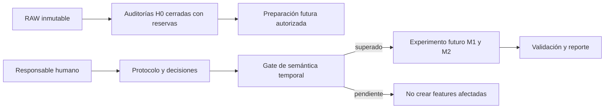

### 7.2 Flujo de artefactos completo

**Qué muestra:** de dónde sale cada artefacto y qué separa el test. **Por qué importa:** hace visible el punto en que las decisiones quedan congeladas.

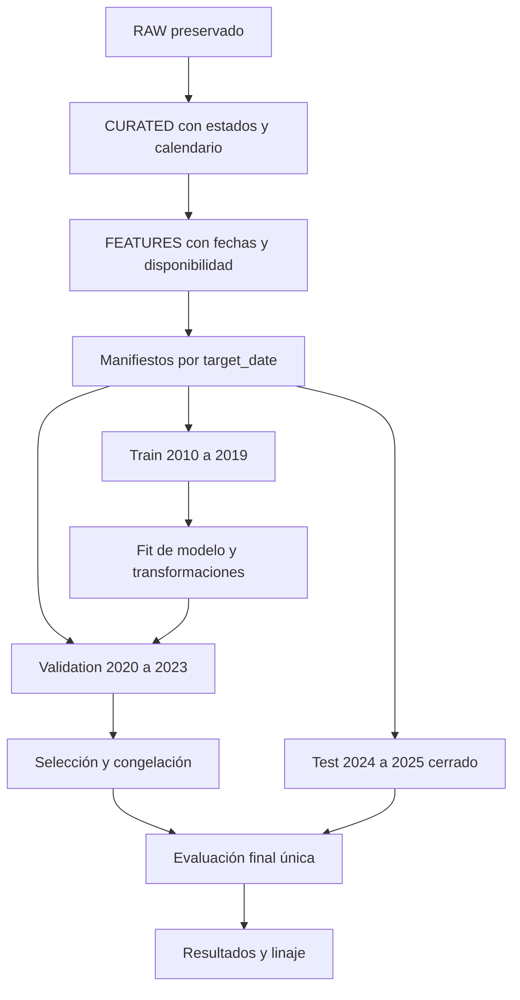

### 7.3 Creación de una muestra por origen

**Qué muestra:** la diferencia entre fecha de origen, lags, disponibilidad y fecha objetivo. **Por qué importa:** un valor etiquetado para un día no es necesariamente conocido en el momento de emitir el pronóstico.

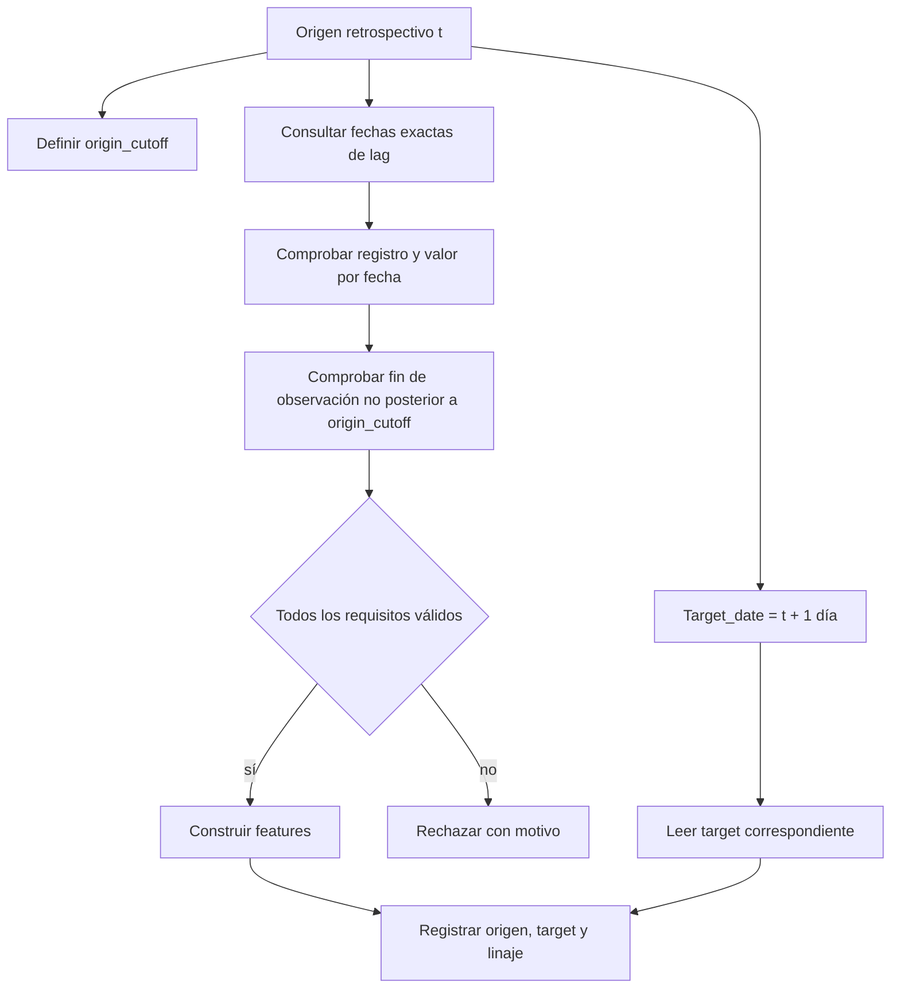

### 7.4 M1: rama térmica

**Qué muestra:** la vista de features térmicos. **Por qué importa:** M1 es el control que M2 debe igualar en todo salvo la información añadida.

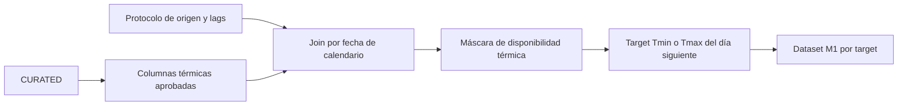

### 7.5 M2: rama térmica más precipitación

**Qué muestra:** el gate adicional de semántica/availability. **Por qué importa:** no basta con tener una columna numérica; primero debe saberse qué intervalo representa y cuándo se conocía.

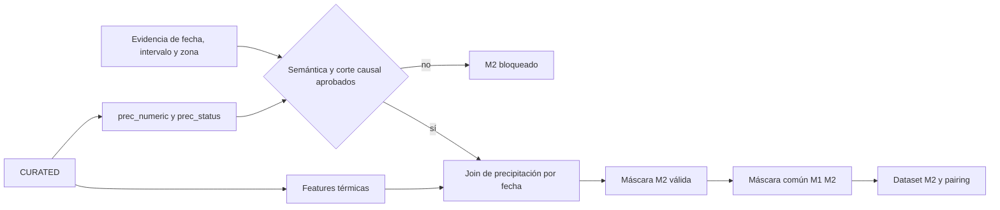

### 7.6 Train, validation y test

**Qué muestra:** las particiones asignadas por fecha del target, con historia previa permitida y parámetros aprendidos solo con train. **Por qué importa:** los lags históricos pueden cruzar un límite de bloque; las etiquetas y el ajuste no.

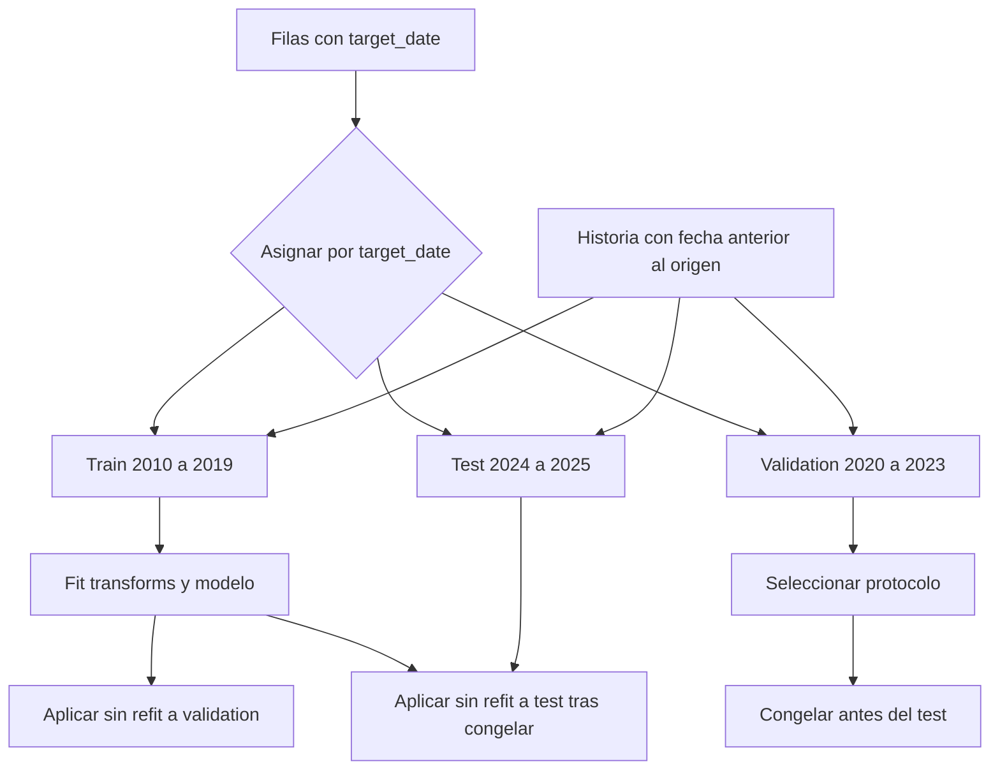

### 7.7 Ejecución del experimento

**Qué muestra:** el orden humano de autorización, análisis, selección y evaluación. **Por qué importa:** el holdout no es una pantalla de depuración iterativa.

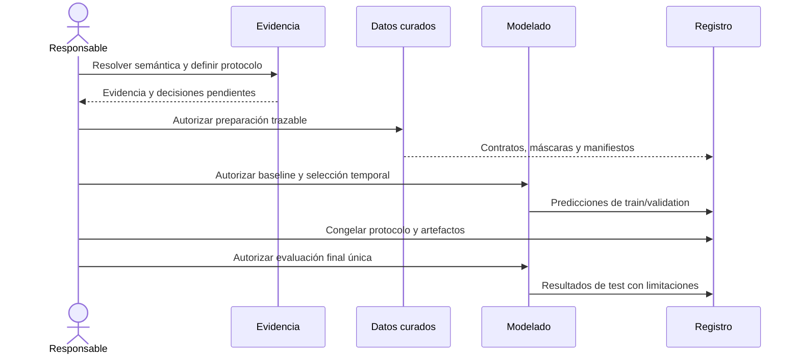

### 7.8 Componentes y frontera Java–Python

**Qué representa:** el recorrido entre AEMET, adquisición Java, originales, PostgreSQL técnico y flujo científico Python. **Decisión:** no hace falta una API interna para un flujo por lotes individual. **Estado:** existe un cliente Java de inventario; adquisición de series, persistencia PostgreSQL y pipeline Python siguen pendientes de implementación y evidencia.

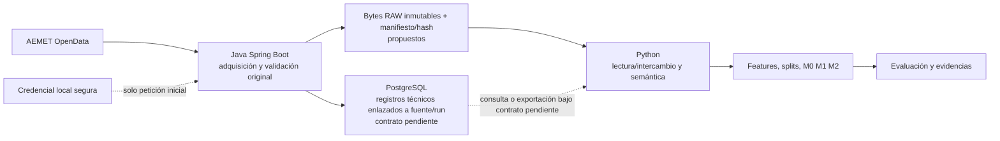

### 7.9 Secuencia de las dos peticiones AEMET

**Qué representa:** el patrón de sobre y URL de datos descrito por la integración actual; muestra fallos de cada etapa y el límite de credencial. **Estado:** verificado en el código para inventario solamente; no acredita llamadas reales ni que el mismo endpoint sirva a una serie diaria.

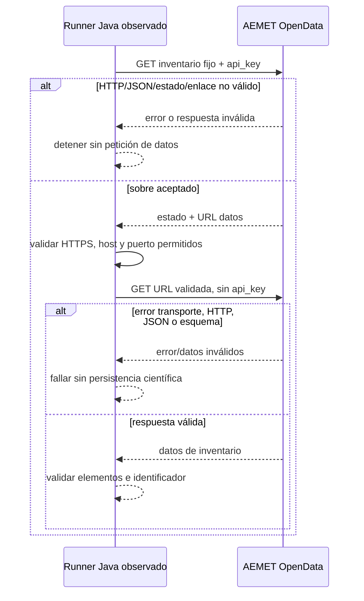

La adquisición futura de series debe añadir validación de periodo/campos, conservación de respuesta original, identificación de ejecución y política de escritura; eso no aparece como realizado en este diagrama.

### 7.10 Adquisición y auditoría del nuevo H0-DATA

**Qué representa:** el futuro gate de reproducibilidad. **Decisión:** una adquisición nueva obtiene un `run_id` y destino propio; comparar ejecuciones sin sobrescribirlas. **Estado:** diseño propuesto, sin datos descargados en esta tarea.

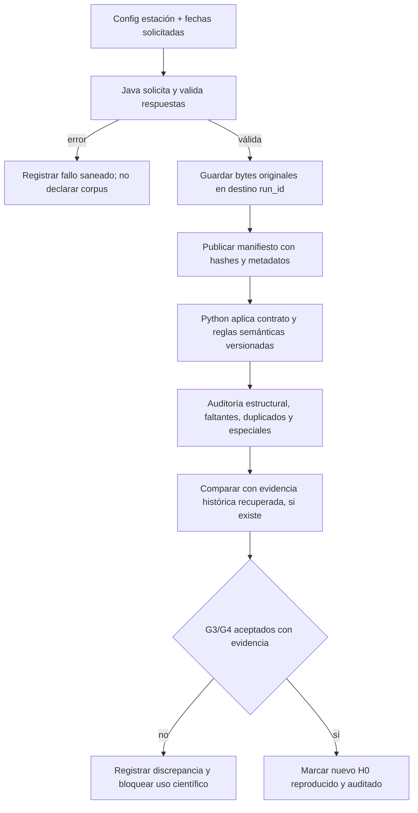

### 7.11 Flujo científico desde archivos hasta evaluación

**Qué representa:** secuencia de análisis ya descrita en esta guía. **Decisión:** separar adquisición de interpretación científica y proteger el holdout. **Estado:** método futuro; ningún modelado se ejecutó aquí.

```mermaid
flowchart LR
  RAW[Originales + manifest] --> C[Python: parseo tipado y estados]
  C --> S[Resolver disponibilidad y semántica]
  S --> L[Lags por fecha natural]
  L --> T[Targets Tmin(t+1) / Tmax(t+1)]
  T --> M[Máscaras comunes por target]
  M --> SP[Split cronológico por target_date]
  SP --> B[Baseline M0]
  SP --> V[Selección train/validation]
  V --> F[Congelar protocolo y artefactos]
  F --> X[Una evaluación final independiente]
  B --> X
  X --> R[MAE, RMSE, N, cobertura, límites]
```

### 7.12 Muestra temporal y fechas comunes M1/M2

**Qué representa:** las claves de origen/target y la intersección exigida para atribuir cambios a precipitación. **Decisión:** comparar por fechas naturales, no por filas tras filtrar. **Estado:** ejemplo conceptual; 07–07 y disponibilidad continúan pendientes.

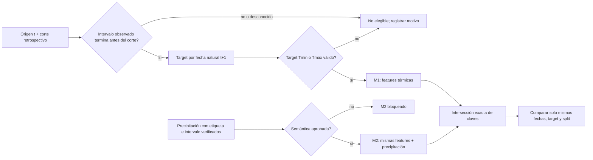

---

## 8. Contratos de datos y experimentos

Los contratos describen campos recomendados, no esquemas ya implementados. Los tipos son conceptuales y pueden mapearse al formato elegido durante la implementación, siempre preservando semántica y estados.

### 8.1 Contrato RAW

| Campo | Tipo/semántica | Nulabilidad/invariante |
|---|---|---|
| `source_path` | Ruta relativa al conjunto de fuentes | Obligatoria; no sustituye la identificación del archivo original |
| `source_file_sha256` | SHA-256 del archivo fuente | Obligatorio cuando el archivo puede hashearse; bytes no prueban semántica |
| `station_id` | Identificador AEMET, por ejemplo `7211B` | Obligatorio; no combinar estaciones en la serie principal |
| `record_date_label` | Fecha literal de etiqueta del registro | Obligatoria si la fuente la provee; no asumir intervalo físico |
| `raw_fields` | Campos y representaciones originales | Preservar originales; no convertir `Acum` en RAW |
| `metadata_source` | Ruta/revisión de metadatos aplicables | Obligatoria para justificar tipos y unidad |
| `ingested_at` | Instante de inventario, si se conoce | Puede faltar en evidencia histórica; no inventarlo |

**Invariantes:** conservar datos originales; detectar claves duplicadas antes de colapsar; mantener por separado propiedad ausente, nula, vacía y marcador cuando la fuente las distingue; registrar transformaciones en otra capa.

### 8.2 Contrato CURATED

| Campo | Tipo/semántica | Nulabilidad/invariante |
|---|---|---|
| `station_id` | Texto | Obligatorio y estable |
| `record_date` | Fecha natural asociada al dato curado | Obligatoria para observación con fecha válida |
| `observed_record` | Booleano: fuente contiene registro ese día | `false` en placeholder de calendario; no significa medida cero |
| `tmin_c`, `tmed_c`, `tmax_c` | Número en °C | Nullable; null no equivale a cero |
| `prec_numeric_mm` | Número en mm | Nullable; `Acum`/missing no son cero |
| `prec_status` | Enum: `NUMERIC_ZERO`, `NUMERIC_NONZERO`, `MISSING`, `SPECIAL_ACUM`, `SPECIAL_IP`, `SPECIAL_OTHER`, `ABSENT_RECORD` según reglas aceptadas | Obligatorio para valor interpretado; enum extensible solo con protocolo |
| `interval_start`, `interval_end` por variable | Timestamp con zona o fecha/horario explícitamente cualificado | Nullable hasta documentar semántica de cada variable |
| `available_at` de publicación por variable | Timestamp con zona, opcional | Solo obligatorio para evaluar operación real; no sustituye el fin del intervalo observado |
| `source_path`, `source_file_sha256` | Linaje | Obligatorios para cada observación |
| `schema_id`, `curation_version` | Identificadores versionados | Obligatorios en salidas futuras |

**Temporalidad por variable:** los intervalos observados (especialmente su fin) se registran por variable, mediante campos específicos o una tabla asociada con clave `(station_id, record_date, variable_name)`. Un corte retrospectivo común no implica intervalos físicos idénticos. La hora de publicación (`available_at`) puede documentarse aparte, si se conoce, pero no se exige para este experimento retrospectivo. Temperatura diaria y precipitación 07–07 pueden corresponder a intervalos distintos.

**Placeholder de calendario:** puede existir una fila lógica para poder encontrar huecos, con `observed_record=false` y variables nulas/estado explícito. No es un registro meteorológico inventado ni debe incluirse como entrenamiento válido salvo regla de imputación predeclarada.

### 8.3 Contrato FEATURES y muestras

| Campo | Tipo/semántica | Invariante |
|---|---|---|
| `station_id` | Texto | `7211B` en experimento principal |
| `forecast_origin_date` | Fecha natural `t` | Unidad de origen; no asigna split |
| `origin_cutoff` | Instante conceptual de corte retrospectivo, con zona/convención documentada | Debe ser posterior al fin de cada observación utilizada y anterior al intervalo objetivo |
| `target_date` | `forecast_origin_date + 1 día natural` | Incluye transición de año y 29 de febrero correctamente |
| `target_name` | `tmin` o `tmax` | Dataset/mascara por target se documenta |
| `target_value_c` | Número Celsius | No nulo para muestra elegible |
| `feature_set_id` | Versión de columnas/convención lag | Igual para setups comparables en columnas comunes |
| `features` | Columnas térmicas y, solo en M2 aprobado, precipitación | Cada columna tiene fecha fuente y fin del intervalo observado verificable; `available_at` solo para escenario operativo |
| `eligible` | Booleano | `true` solo si protocolo completo satisface máscaras |
| `rejection_reasons` | Lista de códigos | Vacía si elegible; si no, causa legible y estable |
| `source_dates`, `source_paths` | Trazabilidad de lags | Suficientes para reconstruir la procedencia de cada feature |

La clave lógica de una predicción es `(station_id, forecast_origin_date, target_name, experiment_id)`. La clave de target de origen es `(station_id, target_date, target_name)`. Si cada target usa observaciones distintas, declararlo expresamente; si la comparación exige pares completos, declarar la pérdida de cobertura de ambos.

**Política abierta de targets ausentes:**

- **Datasets por target:** conserva más casos cuando Tmin y Tmax faltan en fechas diferentes, pero reduce simetría de la comparación conjunta.
- **Pares completos:** permite comparar ambos targets en las mismas fechas, pero descarta observaciones válidas de uno cuando el otro falta.
- **Decisión:** elegir antes del ajuste, publicar N y fechas para cada target, y mantener dentro de cada target las mismas fechas en M1/M2 y entre los modelos comparados.

### 8.4 Contrato SPLITS y manifiestos

| Campo | Tipo/semántica | Invariante |
|---|---|---|
| `split_id` | Identificador versionado | `train_2010_2019`, `validation_2020_2023`, `test_2024_2025` o versión aprobada |
| `target_date` | Fecha que determina partición | Asignar por target, no por origen |
| `target_name` | Tmin/Tmax | Conteos y manifiestos separados cuando filas difieran |
| `sample_key` | Clave de muestra | Única dentro de versión y target |
| `eligible_primary` | Inclusión en análisis principal | Máscara congelada, outcome-independent |
| `eligibility_reason` | Códigos de exclusión | No filtrar por tamaño del error |
| `protocol_id`, `manifest_sha256` | Linaje | Hash identifica bytes del manifiesto, no certifica adecuación metodológica |

**Reglas:** train: targets con fecha 2010-01-01 a 2019-12-31; validation: 2020-01-01 a 2023-12-31; test: 2024-01-01 a 2025-12-31. Las fechas con historia anterior pueden usar pasado de un periodo precedente si esa información existía antes del origen. Las etiquetas del target no cruzan al split anterior. Primer/último día, fechas ausentes y fronteras se validan explícitamente.

### 8.5 Contrato PREDICTIONS

| Campo | Definición |
|---|---|
| `experiment_id`, `protocol_id`, `model_id` | Identificadores de configuración inmutable |
| `station_id`, `forecast_origin_date`, `target_date`, `target_name` | Claves temporales y del objetivo |
| `split_id` | Train/validation/test según manifiesto de target |
| `y_true_c`, `y_pred_c` | Observado y predicho en °C |
| `residual_c` | Definir una sola convención: `y_pred_c - y_true_c` en esta propuesta |
| `absolute_error_c`, `squared_error_c` | Componentes derivables; no sustituir las predicciones originales |
| `feature_set_id`, `eligibility_mask_id` | Enlace a las condiciones de comparación |
| `seed`, `model_config_hash`, `transform_config_hash` | Reproducción cuando aplique |

Debe haber una predicción por clave elegible y configuración. Fallos de ajuste o predicción se registran, no se convierten en targets ausentes.

### 8.6 Contrato METRICS

| Métrica | Definición/uso | Dirección |
|---|---|---|
| `MAE_C` | Media de `abs(y_pred-y_true)` por target/periodo | Menor es mejor; primaria |
| `RMSE_C` | Raíz de la media de errores al cuadrado | Menor es mejor; penaliza más los errores grandes |
| `bias_C` | Media del residual firmado; con convención propuesta, predicción menos observado | Cero es ausencia de sesgo medio; mostrar signo |
| `N` | Número de pares observación-predicción válidos | Mayor cobertura no implica más precisión |
| `coverage` | N elegible / N objetivo según manifiesto | Mostrar denominador y regla |
| `delta_MAE_C` | MAE M2 menos MAE M1 en mismas fechas | Negativo favorece M2 |
| `relative_delta_MAE` | `(MAE_M2-MAE_M1)/MAE_M1` si MAE_M1>0 | No definir como válido si denominador es cero; reportar diferencia absoluta |

MAE se expresa en grados Celsius. No promediar dos targets para la selección primaria sin declarar previamente si se usa media simple, ponderación u otra regla. Mostrar siempre métricas individuales por target.

### 8.7 Contrato de metadatos de experimento

Registrar, como mínimo:

- `experiment_id`, fecha, responsable y estado (planificado/ejecutado/fallido/congelado).
- Estación, fuentes relativas, hashes de RAW/curated y caveats de procedencia.
- `schema_id`, versiones de curation/features, convención de `lag`, longitudes y columnas exactas.
- Definición de `origin_cutoff`, relación etiqueta/intervalo observado, unidad y target; `available_at` de publicación solo si se evalúa disponibilidad operativa.
- Reglas de missing/especial, `Acum`, posibles `Ip`, discontinuidades y máscara elegible.
- Split y hashes de manifiestos por target; fechas emparejadas de M1/M2.
- Familia, parámetros, preprocessing, semilla, versiones de librerías/runtime cuando se conozcan.
- Número de configuraciones, folds si los hay, ajuste permitido y presupuesto consumido.
- Métricas, dirección, unidades, N, resultados por año y criterio práctico predeclarado.
- Fallos, desviaciones, decisiones posteriores y limitaciones conocidas.

Un SHA-256 confirma igualdad de bytes frente a un referente, no quién produjo el archivo, qué periodo representa ni si una etiqueta está bien alineada. Mantener por separado hashes, ruta, estación-periodo, procedencia y decisión semántica.

### 8.8 Contrato propuesto Java–Python y política de adquisición

**DECIDIDO en alcance / contrato detallado PENDIENTE:** cada adquisición conserva los bytes originales sin transformación en archivos inmutables, un manifiesto `glea-weather.acquisition-manifest/v1`, identidad de run y hashes comprobables. Java/Spring Boot mantiene además persistencia técnica consultable en PostgreSQL y enlazada a la fuente/run. CSV es una exportación/intercambio opcional, no formato obligatorio de original ni almacenamiento paralelo obligatorio. Si la respuesta original es JSON, filas normalizadas o CSV son derivaciones y nunca sustituyen sus bytes. Python interpreta semánticamente y produce calendario, estados, features, splits y evaluación con trazabilidad al original/run. No se declara implementación actual. La alternativa histórica de §4.1/§5.5 de archivos sin base de datos queda reemplazada por esta decisión de 2026-10-18; el esquema, mecanismo de carga/consulta, transacción, política de reintento y comportamiento ante fallos siguen **PROPUESTOS/PENDIENTES en G2**. No afirmar atomicidad filesystem–DB sin mecanismo aprobado.

Campos del registro: conservar sin reinterpretar `indicativo`/`station_id` como texto; campo fecha original y valor literal; `tmin`, `tmed`, `tmax` y `prec` como cadenas RAW tal como llegan hasta que se verifique el esquema de respuesta. En la capa tipada propuesta, fechas son `date`, temperaturas `decimal?` en °C, precipitación `decimal?` en mm, y cada variable lleva estado (`NUMERIC`, `MISSING`, `SPECIAL`, `ABSENT_RECORD`, `UNPARSED`). Estas unidades y nombres tipados son **propuesta derivada de la guía histórica**, no validados con fuente primaria ni contrato AEMET vigente en esta revisión. No asignar significado físico a `Acum`, `Ip` ni fechas hasta validar fuente.

Campos mínimos propuestos del manifiesto:

| Campo | Tipo y ejemplo ilustrativo | Regla |
|---|---|---|
| `contract_id` | texto: `glea-weather.acquisition-manifest/v1` | Versiona el significado del manifiesto |
| `run_id` | UUID | Único por intento; un intento fallido no se presenta como corpus completo |
| `station_id` | texto: `7211B` (ejemplo basado en estación decidida) | Identidad observada, no solo solicitada |
| `requested_period` | `{"from":"2010-01-01","to":"2025-12-31"}` (ejemplo ilustrativo) | No equivale a fechas efectivamente recibidas |
| `actual_period` | fechas observadas o `null` | Registrar rango real; no inferir extremos faltantes |
| `requested_at`, `completed_at` | timestamp ISO-8601 con offset o `null` | Tiempos reales UTC normalizados más offset original si se captura; omitir si no se observan |
| `source` | proveedor/endpoint lógico/versionado | No incluir query, token ni URL con credenciales |
| `files[]` | ruta relativa, bytes, SHA-256, rol, registro count si válido | Hash de cada archivo original, no hash recursivo del propio manifiesto |
| `request_metadata` | parámetros no secretos saneados | Redactar API keys, tokens, cabeceras sensibles y datos personales |
| `result` | `complete`, `partial`, `failed` | Solo `complete` puede alimentar H0 tras auditoría; respuesta parcial se conserva y marca como incompleta |
| `software` | Java/runtime y versión conocida | Registrar valores reales, nunca inventarlos |
| `notes` | texto | Caveats y errores observables, no causa raíz no demostrada |

**Integridad no equivale a autenticidad:** SHA-256 detecta diferencias de bytes frente a un digest confiable; no demuestra origen, autoría ni veracidad semántica. No incluir hash del manifiesto dentro del mismo manifiesto: es autorreferencial. Si se necesita un digest de manifiesto, calcularlo externamente sobre sus bytes finales y guardarlo en un índice/registro separado. 

Ejemplo **ilustrativo propuesto**, no salida real ni esquema ya aprobado:

```yaml
contract_id: glea-weather.acquisition-manifest/v1
run_id: "<uuid-generado-por-ejecucion>"
station_id: "7211B"
requested_period: {from: "2010-01-01", to: "2025-12-31"}
actual_period: null
requested_at: null
completed_at: null
source: "AEMET OpenData; endpoint lógico pendiente de validar para series"
result: failed
files: []
request_metadata: "parámetros saneados; sin api_key ni URL firmada"
software: {application_version: "desconocida", runtime_version: "desconocida"}
notes: "ejemplo: los valores nulos evitan inventar una ejecución"
```

**Regeneración:** cada ejecución va a una ruta nueva `raw/<station>/<period>/<run_id>/`; no sobrescribir. Tras verificar bytes y metadatos, comparar hashes y filas/campos contra una ejecución anterior con informe de diferencias. Solo una decisión explícita puede designar una ejecución como referencia actual; conservar la anterior según política de retención pendiente. No copiar ni alterar evidencia histórica durante diseño.

### 8.9 Requisitos funcionales, no funcionales y metodológicos

Los criterios son especificaciones futuras, no pruebas ejecutadas. Estados: **DECIDIDO**, **PROPUESTO** o **PENDIENTE**; véase también el [plan y backlog enlazados](GLEA-WEATHER-PLAN-REVISADO.md).

| ID | Requisito | Origen / justificación | Criterio de aceptación verificable | Evidencia esperada | Estado | Dependencias |
|---|---|---|---|---|---|---|
| RF-01 | Adquirir para estación y rango solicitados usando Java/Spring Boot | Decisión del responsable, respaldada por consulta al tutor reportada; la propuesta PDF menciona Python | Ejecución real documenta parámetros solicitados, respuesta y rango observado | RAW, manifiesto, registro de ejecución | Diseño aprobado; implementación y evidencia de ejecución PENDIENTES | G2 técnico; la consulta tecnológica ya no es dependencia |
| RF-02 | Validar HTTP, JSON/esquema e identificador de estación | Decisión del responsable, integración existente y protección de datos | Respuesta inválida falla explícitamente y no publica un corpus completo válido | Casos de integración y respuesta inválida; ejecución real cuando se adquiera | Diseño aprobado; implementación y prueba de serie PENDIENTES; inventario Java observado no es evidencia de serie | RF-01 |
| RF-03 | Conservar respuesta fuente inmutable y mantener persistencia técnica consultable en PostgreSQL trazable a fuente/run | Reproducibilidad y práctica de integración Spring Boot–PostgreSQL; no necesidad supuesta de Big Data | Original bytes recuperable/hashable en ruta única por run; registros técnicos consultables enlazan run/original; repetir carga del mismo run no duplica accidentalmente; nueva adquisición recibe nueva identidad; fallos/incompletos no se presentan como completos; original permanece recuperable ante fallo de BD | Originales + manifiesto/run/hash; comprobación de consulta/linaje, reintento e incompletitud; política filesystem–BD | Diseño de dirección aprobado; contrato detallado de esquema/carga/fallos PENDIENTE; implementación y evidencia PENDIENTES | RF-01, RF-02, G2 |
| RF-04 | Registrar periodo solicitado y observado, procedencia, tiempos y estado | Reproducibilidad | Manifiesto permite distinguir pedido, resultado parcial y completo sin secretos | Manifiesto saneado y revisión de secretos | PROPUESTO | RF-03 |
| RF-05 | Auditar integridad y calidad tras interpretar datos | H0 reproducible | Reportar fechas, duplicados, faltantes, parseos y especiales por campo | Informe de auditoría reproducible | PROPUESTO | RF-04, G3 |
| RF-06 | Transformar semánticamente en Python, sin alterar RAW | Límite Java–Python decidido | Derivados referencian contrato, original y versión de transformación | Esquema/ejemplo y linaje de salidas | DECIDIDO | RF-03 |
| RF-07 | Crear targets Tmin(t+1) y Tmax(t+1) por fecha natural | Propuesta académica | Target fecha igual a origen + 1 día natural, incluido año bisiesto | Dataset de features/manifiesto con fechas | DECIDIDO | RM-01, RM-02 |
| RF-08 | Calcular y reportar M0 persistencia por target si causalmente admisible | Requisito de baseline | Baseline usa solo valor disponible al origen; si no se demuestra, se bloquea y registra | Regla, predicciones y métricas | PROPUESTO | RM-02, G5 |
| RF-09 | Comparar M1 térmico y M2 térmico + precipitación | Pregunta científica | Para cada target comparar mismas claves y protocolo; M2 bloqueado hasta semántica aprobada | Máscara común, métricas y exclusiones | DECIDIDO; ejecución PENDIENTE | RM-03, RM-04, G5 |
| RF-10 | Persistir configuración, predicciones, métricas y limitaciones | Reproducción y defensa | Se puede reconstruir cada resultado con manifiesto, protocolo y versiones disponibles | Artefactos de experimento | PROPUESTO | RF-09, RM-07 |
| RNF-01 | Credenciales fuera del código, archivos de datos y logs | Seguridad básica | Inspección no encuentra secretos en RAW, manifiestos, errores ni ejemplos | Revisión de artefactos y redacción | PROPUESTO | RF-01, RF-04 |
| RNF-02 | Mantener separación clara entre adquisición y ciencia | Responsabilidades decididas | Java no calcula features/targets; Python no define peticiones ni modifica originales | Revisión de arquitectura/contratos | DECIDIDO | RF-01, RF-06 |
| RNF-03 | Preservar trazabilidad desde el original hasta métricas | Reproducibilidad | Cada salida enlaza run/hash, transformación, protocolo, máscara y configuración | Linaje navegable en artefactos | PROPUESTO | RF-03, RF-06, RF-10 |
| RNF-04 | Contrato con versión y evolución explícita | Interoperabilidad Java/Python | Cambio incompatible crea nueva versión; lectores rechazan versión desconocida | Esquema versionado y ejemplo de compatibilidad | PROPUESTO | RF-06 |
| RM-01 | No sustituir Tmin/Tmax por Tmed | Propuesta académica | Targets son Tmin y Tmax independientes en todas las salidas | Configuración y tabla de resultados por target | DECIDIDO | — |
| RM-02 | Lags por fecha calendario y causalidad retrospectiva | Causalidad temporal | Cada feature guarda fecha e intervalo observado; se rechaza fecha ausente o intervalo que sobrepase `origin_cutoff` | Manifiesto de elegibilidad | PROPUESTO; corte/intervalos PENDIENTES | Evidencia de intervalos, G5 |
| RM-03 | Resolver periodo 07–07, etiqueta, zona y corte retrospectivo antes de M2 | Evitar leakage y semántica inventada | Fuente primaria justifica inicio/fin del intervalo, etiqueta y uso previo al corte; publicación operativa no es requisito del TFC actual | Registro de evidencia y decisión por variable | PENDIENTE | RF-05, G5 |
| RM-04 | M1/M2 comparables sobre fechas comunes por target y split | Atribuir cambio a precipitación | Claves exactas, target, protocolo y presupuesto iguales; reportar N/cobertura | Manifiesto de pairing y tabla de resultados | PROPUESTO | RM-03, RF-09 |
| RM-05 | Proteger test final y separar validación | Evitar sobreajuste de selección | Protocolo/modelo congelados antes de abrir test; ninguna decisión posterior se afina con test | Registro de protocolo y única salida final | PROPUESTO | RM-06, G7 |
| RM-06 | Usar split cronológico sin shuffle, candidato por `target_date` | Integridad temporal | Sin solapamiento; train 2010–2019, validación 2020–2023, test 2024–2025 solo tras reproducir y aprobar | Manifiestos y casos de frontera | PROPUESTO; corpus pendiente | RF-05, G4 |
| RM-07 | Preprocesamiento aprendido se ajusta solo en train | Prevenir leakage | Parámetros fit proceden solo de train; valid/test solo transforman | Configuración, código futuro y registro de fit | PROPUESTO | RM-06 |
| RM-08 | Reportar MAE primaria, RMSE secundaria, por Tmin/Tmax | Lectura interpretable | Unidades °C, signo de residuo, N y cobertura/denominador reportados | Tabla/reporte de evaluación | PROPUESTO | RF-10 |
| RM-09 | Conservar missing, `Acum` y futuros especiales como estados distintos | No inventar observaciones | Ninguna conversión implícita de especial/missing a cero ni salto de fecha al construir lag | Auditoría de estados y tests futuros | PROPUESTO; semántica fuente pendiente | RF-05, RM-06 |
| RM-10 | Reproducir el procedimiento desde datos, protocolo y configuración | Evidencia defendible | Una repetición controlada genera mismos artefactos deterministas o documenta variabilidad/fallos | Re-ejecución, hashes y diferencias | PROPUESTO | RF-10, RNF-03 |

### 8.10 Registro histórico y pendientes de evidencia

| Antecedente citado en la guía anterior | Estado tras esta revisión | Evidencia necesaria para elevarlo a VERIFICADO |
|---|---|---|
| H0 exploratorio `GREEN_WITH_CAVEATS`, 5.844 filas `7211B` y conteos por variable | REALIZADO según el responsable; fuente primaria no localizada en esta revisión | Recuperar fuentes para cotejo/comparación histórica (recomendado); el nuevo H0-Java se acredita con sus propias evidencias |
| H0-02: 4.883 ceros, 801 no-cero, 159 missing, un `Acum` | REALIZADO según el responsable; conteos no recotejados aquí | Informe H0-02 y corpus referenciado (recomendados para cotejo, no precondición de nueva adquisición) |
| Intervalo diario `07–07`, semántica `Ip` y `Acum` | PENDIENTE de verificación autoritativa | Documento primario AEMET aplicable, versión/fecha y decisión de alineación |
| H0-04 lags 1/3/7/14, H0-05 estaciones alternativas, H0-06 humedad | REALIZADOS según el responsable; artefactos primarios no localizados aquí | Recuperar auditorías si se desea contrastar históricos; no transferir resultados automáticamente al corpus nuevo |
| 21 tests Java comunicados por responsable | HISTÓRICO/reportado; no ejecutado en esta sesión | Salida de ejecución verificable de la tarea concurrente o ejecución autorizada futura |
| Integración Java de inventario | VERIFICADO por inspección de `weather/src/main/java/com/glea/weather/AemetRunner.java` | No implica llamada de red ni descarga de observaciones diarias |

---

## 9. Fase 1 — Análisis y preparación conceptual

| Objetivo | Entradas | Salidas | Dependencias | Alternativa / decisión pendiente | Criterio de finalización |
|---|---|---|---|---|---|
| Aclarar problema, población, fuentes, tiempos y riesgos antes de transformar datos | Propuesta académica, decisión Java/Python, conocimiento H0 exploratorio | Requisitos, modelo conceptual, inventario de riesgos y registro de decisiones | Revisión documental y acceso a fuentes primarias para semántica | Mantener experimento retrospectivo; la elección Java/Python cuenta con consulta al tutor reportada; objetivos científicos nuevos requieren revisión específica | G1 revisado; incógnitas científicas se asignan al gate que bloquea la feature afectada |

Esta fase convierte el problema narrativo en un conjunto de reglas medibles. No se inicia entrenamiento para «ver qué pasa» mientras continúen abiertas las condiciones que definen la muestra.

### Paso 1. Definir corte retrospectivo e intervalos observados

- **Problema:** una fecha diaria no fija el instante en que se conocen Tmin, Tmax o precipitación.
- **Entrada:** metadatos AEMET aplicables, intervalos físicos y definición del experimento retrospectivo D+1.
- **Salida:** tabla por variable con etiqueta, inicio/fin observado, zona y `origin_cutoff`; publicación `available_at` se añade solo si se estudia operatividad.
- **Dependencia:** ninguna feature se congela sin esta definición.
- **Decisión:** conservar alcance retrospectivo; si el intervalo de una feature no permite justificar su uso anterior al corte, bloquear solo esa feature y registrar la incertidumbre.
- **Riesgo:** mover precipitación un día porque «parece correcto» cambia el experimento sin evidencia.
- **Evidencia de salida:** fuente citada, regla inequívoca y revisión humana.

### Paso 2. Definir unidad y calendario

- **Problema:** compactar filas ausentes hace que el lag nominal deje de ser un día natural.
- **Entrada:** fechas originales, estación y periodo objetivo.
- **Salida:** modelo de calendario lógico con indicador de registro observado.
- **Dependencia:** paso 1 y contrato CURATED.
- **Decisión:** join por fecha esperada, nunca `fila anterior` tras filtrar missing.
- **Riesgo:** inventar datos al materializar días inexistentes.
- **Evidencia de salida:** invariantes de fecha diaria, duplicados y estado explícito de placeholder.

### Paso 3. Congelar targets, horizonte y política de ausencias

- **Problema:** las dos temperaturas pueden faltar en fechas diferentes.
- **Entrada:** serie/target y protocolo temporal aprobado; los bloques preliminares siguen pendientes de verificación.
- **Salida:** regla por target: dataset independiente o pares completos; lista de denominadores.
- **Dependencia:** unidad/fecha de target definidas.
- **Decisión:** no descartar una fecha elegible de Tmin por faltar Tmax, salvo política de pares completos acordada antes.
- **Riesgo:** ocultar diferencias de población al presentar una media conjunta.
- **Evidencia de salida:** fechas y N potencial por target antes de modelar.

### Paso 4. Congelar candidatos de columnas y lags

- **Problema:** cada ventana y definición lag cambia features y elegibilidad.
- **Entrada:** tabla de disponibilidad y listas candidatas de lags `{0..L-1}` y `{1..L}`.
- **Salida:** conjunto térmico exacto, política de lag, ventanas candidatas y reglas de missing.
- **Dependencia:** paso 1; para precipitación, el gate semántico 07–07.
- **Decisión:** seleccionar primero por causalidad y luego comparar candidatos predictivos con datos de train/validation.
- **Riesgo:** evaluar lag 0 como si estuviese disponible al origen.
- **Evidencia de salida:** contrato `feature_set_id` firmado antes del ajuste.

### Paso 5. Definir máscaras y población primaria

- **Problema:** M1 y M2 pueden diferir por missing de precipitación.
- **Entrada:** predictores, targets, lags y regla de fechas válidas.
- **Salida:** máscara por setup/target y máscara común, con motivos de exclusión.
- **Dependencia:** pasos 2–4.
- **Decisión:** para atribuir diferencias a precipitación, comparación principal en fechas comunes válidas por target. Reportar aparte el M1 en toda su población admisible.
- **Riesgo:** selección de fechas depende de disponibilidad climática; la población común puede no representar el universo completo. Es una limitación de validez externa.
- **Evidencia de salida:** manifiesto de claves iguales antes de calcular métricas.

### Paso 6. Fijar particiones

- **Problema:** temporalidad y etiquetas futuras pueden cruzar fronteras.
- **Entrada:** `target_date`, periodos H0 y calendario completo.
- **Salida:** manifiestos train/validation/test por target.
- **Dependencia:** paso 3 y máscara primaria definida.
- **Propuesta pendiente:** asignación por fecha target con bloques candidatos 2010–2019, 2020–2023 y 2024–2025; aprobar tras reproducir el corpus.
- **Riesgo:** usar la fecha de origen asignaría a train una etiqueta de validation/test.
- **Evidencia de salida:** no hay target compartido entre bloques; casos de frontera comprobados.

### Paso 7. Confirmar procedencia de evidencia

- **Problema:** un hash histórico no repara salidas sobrescritas.
- **Entrada:** rutas actuales, manifiestos, H0-03 y delimitación por estación/periodo.
- **Salida:** registro que distingue resultado histórico de evidencia reproducible actual.
- **Dependencia:** antes de una reproducción formal de H0-03.
- **Decisión:** cualquier auditoría futura escribe a destino separado estación-periodo y no pisa salidas previas.
- **Riesgo:** reproducir un resumen atribuyéndolo a una estación incorrecta.
- **Evidencia de salida:** ruta, origen y periodo explícitos; caveat comunicado.

---

## 10. Fase 2 — Estrategia experimental

| Objetivo | Entradas | Salidas | Dependencias | Alternativa / decisión pendiente | Criterio de finalización |
|---|---|---|---|---|---|
| Convertir el análisis en pasos repetibles y una comparación justa | G1, nueva adquisición auditada, semántica de variables | Contrato, protocolo, particiones, máscaras y presupuesto | G2–G5 en orden; no crear M2 antes de resolver disponibilidad | PostgreSQL queda como práctica técnica acotada; el contrato/schema concreto se elige en G2 sin presumir escala ni ORM | Cada hipótesis y cada exclusión tienen criterio verificable antes del ajuste |

### 10.1 Orden recomendado

| Paso | Objetivo y entrada | Salida | Dependencia | Alternativa o decisión pendiente | Finaliza cuando |
|---|---|---|---|---|---|
| 1. Corte e intervalos | Definir pregunta retrospectiva, corte e intervalos con evidencia | Decisión temporal por predictor y bloqueos | G4 y fuentes primarias | No extenderse a predicción operativa salvo decisión futura; consulta al tutor ante cambios sustantivos de alcance | Cada variable queda admisible o excluida con razón/evidencia |
| 2. Contrato y protocolo | Acordar esquema, targets, unidad, métricas, splits y protecciones | Contrato versionado y protocolo revisable | Paso 1, G1 | Resolver en G2 el esquema/carga mínima PostgreSQL, dejando archivos fuente como originales inmutables | Versiones, aceptación y frontera de test aprobadas |
| 3. Curado | Tipar originales preservando missing/especiales | Capa derivada con estados y linaje | Pasos 1–2, G4 | Rechazar dato no interpretable o mantenerlo como estado; nunca coerción silenciosa | Calidad y conteos por estado comprobables, RAW idéntico |
| 4. Features | Recuperar cada predictor por fecha natural exacta | Candidatos de lags con fechas fuente | Paso 3, G5 | Ventana común o máscaras diferentes; elegir antes de scores y reportar población | No hay lag por posición ni disponibilidad desconocida sin bloqueo |
| 5. M1/M2 y máscaras | Formar target t+1 y pairing por target/split | Datasets, máscaras y razones de exclusión | Pasos 1–4; precipitación solo después de G5 | Mantener M2 bloqueado si la lluvia no es elegible | Claves comunes exactas y N/cobertura publicada |
| 6. Baseline | Obtener referencia simple causal por Tmin/Tmax | Predicciones M0 y regla | Paso 5 | Persistencia si disponible; climatología aprendida solo en train; no baseline si ambos son inválidos | Regla, fechas y disponibilidad reproducibles |
| 7. Modelos candidatos | Responder hipótesis con pocas configuraciones equitativas | Artefactos y registro de ajustes | Paso 6; G6 | Modelo sencillo como mínimo; familia más compleja solo con motivo y presupuesto | Presupuesto acotado, fit solo train y fallos registrados |
| 8. Validación | Selección temporal antes de test | Comparación por target con diagnóstico | Paso 7; validation aprobada | Reportar inconcluso si cobertura/criterio insuficiente | Selección y limitaciones documentadas sin consultar test |
| 9. Freeze | Congelar features, parámetros, transformaciones, máscaras, métricas y semillas | Manifiesto de protocolo congelado | Paso 8 | Si queda decisión abierta, retrasar test; no resolver usando test | Registro fechado anterior a predicciones finales y aprobado (G7) |
| 10. Test e informe | Estimar desempeño independiente y comunicar límites | Evaluación por target, pairing, N y evidencia | Paso 9; G8 | Resultado negativo/incompleto se informa; nunca retunar sobre el mismo holdout | Una ejecución final trazable, resultados reproducibles o variabilidad explicada |

### 10.2 Objetivo primario y secundarios

**DECISIÓN — propuesta:** `MAE` por target en validation sobre fechas comunes es el criterio principal para comparar M1/M2; `RMSE`, sesgo, N y cobertura son secundarios obligatorios de interpretación.

**MOTIVO:** MAE mantiene las unidades y limita cuánto domina un único error grande; RMSE sigue siendo útil para hacer visible una cola de errores grandes.

**ALTERNATIVAS:** seleccionar por RMSE, por promedio de ambos targets o por mejora en un solo target.

**VENTAJAS:** resultado primario interpretable; evita que la escala o un target oculte al otro; deja un criterio reproducible.

**INCONVENIENTES:** una mejora de MAE puede coexistir con peores errores extremos o con deterioro en el otro target.

**RIESGOS:** declarar ganador por un decimal sin incertidumbre o relevancia práctica.

**CRITERIO DE ELECCIÓN:** antes de ver validation, decidir si se requiere mejora en ambos targets o se permite una conclusión específica por target; fijar umbral de relevancia práctico con justificación. Si no se puede justificar umbral, reportar diferencias sin atribuir importancia operacional.

### 10.3 Baseline antes de complejidad

Comparar cada candidato con:

1. **Persistencia**, solo si el valor persistido está disponible en el instante de origen según la regla causal.
2. **Referencia climatológica** opcional: media u otra regla estacional calculada exclusivamente con train. Especificar tratamiento de 29 de febrero (p. ej., vecindad de día del año o fallback definido) y evitar estimadores que usen el año de validación.

Un baseline que use el valor del día objetivo o una temperatura diaria aún no conocida es inválido aunque sea muy fuerte. Baseline y candidatos comparten fechas y el mismo protocolo de target.

### 10.4 Temporalidad y validación adicional

La partición candidata train 2010–2019, validation 2020–2023 y test 2024–2025 no está verificada ni aprobada por este documento. Si se confirma en el protocolo reproducido, se pueden calcular métricas por año dentro de validation para hacer visible estabilidad sin cambiar el modelo ni la frontera de selección.

Una validación cronológica adicional dentro del train puede estimar sensibilidad a años/ventanas, si el coste y el diseño están justificados. No reemplaza la validation definida por el protocolo aprobado ni desplaza silenciosamente las fronteras. No proponer como protocolo principal un expanding refit a través de validation sin decisión explícita: transformaciones aprendidas se ajustan en train y se aplican sin refit a validation/test.

`TimeSeriesSplit` define `gap` en muestras y señala que la comparabilidad temporal de folds supone observaciones igualmente espaciadas. En una tabla diaria con huecos o máscaras distintas, un gap de N filas no equivale automáticamente a N días. Consultar la documentación oficial antes de justificar folds: [TimeSeriesSplit](https://scikit-learn.org/stable/modules/generated/sklearn.model_selection.TimeSeriesSplit.html) y [cross-validation](https://scikit-learn.org/stable/modules/cross_validation.html). No copiar ejemplos con shuffle en un experimento temporal.

### 10.5 Ajuste, presupuestos y parada

**INFERENCIA / PROPUESTA:** definir un presupuesto pequeño antes de ejecutar. Como ejemplo de planificación —no como obligación ni resultado— un máximo de 36 configuraciones emparejadas entre setup, target y familia da hasta 144 fits si cada configuración ajusta los dos targets en M1 y M2; el total debe recalcularse si hay folds o seeds adicionales. Anotar cantidad de ajustes, no solo cantidad de configuraciones.

Limitar primero variables que importan: familia, ventana y pocos hiperparámetros plausibles. No recorrer una grilla grande por rutina. Una regla de parada podría exigir agotar el presupuesto o no encontrar mejora superior al umbral práctico predefinido tras una etapa; el umbral se selecciona sin mirar el test.

Errores diarios consecutivos no son muestras independientes. Una incertidumbre basada en remuestreo, si se necesita, debe considerar bloques temporales; un block bootstrap es una posibilidad, pero elegir longitud de bloque necesita justificación y pocos bloques anuales limitan inferencias. No se requiere añadir herramientas estadísticas complejas para un informe de alcance limitado.

---

## 11. Fase 3 — Optimización del proceso y del modelo

| Objetivo | Entradas | Salidas | Dependencias | Alternativa / decisión pendiente | Criterio de finalización |
|---|---|---|---|---|---|
| Reducir duplicación, esfuerzo y complejidad sin cambiar la pregunta a posteriori | Flujo auditado, presupuesto y resultados de train/validation autorizados | Simplificaciones justificadas, protocolo y artefactos congelados | Gates previos; acceso al test continúa cerrado | Automatizar solo pasos manuales repetidos con errores/coste observados; no hacer tuning en esta tarea | Procedimiento reproducible, sin leakage ni selección basada en test |

Optimizar proceso (menos tiempo, más trazabilidad) y optimizar predictor (menor error fuera de train) son problemas distintos. No aceptar una mejora predictiva a costa de esconder población, leakage o coste no reportado.

### 11.1 Optimización del proceso

| Acción candidata | Beneficio | Coste/riesgo | Cuándo aplicarla |
|---|---|---|---|
| Una tabla maestra CURATED y vistas M1/M2 | Reduce duplicación y facilita igualdad de columnas | Requiere contrato de columnas/versiones claro | Desde el primer dataset preparado |
| Manifiestos de fechas/máscaras reutilizados | Evita comparar muestras distintas | Más artefactos a custodiar | En toda comparación principal |
| Cache de transformaciones deterministas | Evita repetir cálculos caros | Riesgo de cache obsoleta si falta versionado | Solo si profiling mide repetición costosa; key debe incorporar inputs/config/hashes |
| CSV/JSON de resultados y metadata | Simple, inspeccionable y portable | No sustituye una base de experimentos a gran escala | Suficiente mientras el proyecto sea pequeño |
| Pipeline de preprocessing ajustado en train | Hace explícito el límite de fit | Algo más de configuración | Cuando se aprendan imputación/escalado |

La persistencia técnica PostgreSQL está aceptada como práctica acotada de integración, no como respuesta a una necesidad de escala medida. No añadir tracker de experimentos ni infraestructura distribuida sin una necesidad demostrada. Las librerías planeadas no se verificaron como instaladas y no se instaló ninguna dependencia durante este trabajo.

### 11.2 Optimización del predictor

**DECISIÓN — propuesta:** usar una escalera corta: persistencia admisible → OLS → Ridge → una familia no lineal elegida por hipótesis y coste. Lasso/ElasticNet, Random Forest, Gradient Boosting o KNN son alternativas condicionales, no una lista que haya que ejecutar completa.

**MOTIVO:** cada familia debe responder una pregunta (linealidad, regularización, interacción no lineal), no inflar el número de oportunidades de hallar una variación accidental.

**ALTERNATIVAS:** probar de inicio muchas familias, redes profundas o una búsqueda automática grande.

**VENTAJAS:** facilita explicar qué cambia, controlar el presupuesto y detectar sobreajuste temprano.

**INCONVENIENTES:** un modelo no probado puede capturar señal no lineal que la escalera no ve.

**RIESGOS:** elección prematura del único modelo no lineal o una búsqueda manual sesgada.

**CRITERIO DE ELECCIÓN:** añadir solo si una hipótesis concreta, validación temporal, coste estimado y regla de parada están escritos antes de ejecutar; todas las familias comparadas comparten muestras y presupuesto razonable.

XGBoost solo se considera si una prueba controlada demuestra valor sobre Gradient Boosting u otra opción ya disponible y el coste/instalación se autoriza por separado. Deep learning/LSTM no se recomienda para este experimento pequeño sin evidencia de que el volumen, la estructura y el objetivo lo justifican.

---

## 12. Fase 4 — Validación y comunicación

| Objetivo | Entradas | Salidas | Dependencias | Alternativa / decisión pendiente | Criterio de finalización |
|---|---|---|---|---|---|
| Verificar datos, causalidad, comparación y límites antes de formular conclusión | Contratos, manifiestos, artefactos congelados y métricas | Evidencias G1–G8 y reporte por target | G1–G7; test solo después de freeze | Reportar inconcluso si falla cobertura/evidencia; no cambiar protocolo sobre el holdout | Cada gate tiene evidencia, discrepancias, fallos y limitaciones registradas |

Validar no es ejecutar una sola métrica. Es comprobar separadamente que la tabla, el pipeline, el modelo y la conclusión respetan sus contratos.

### 12.1 Validación de datos

- Clave estación-fecha única según política de duplicados.
- Rango de fechas y calendario comprobados; placeholder marcado como no observado.
- Unidades, tipos y estados de null/especial diferenciados.
- Para cada lag, fecha calendario exacta y source date registrada.
- `Acum` no se convierte a cero y los 159 missing históricos no se llaman días secos.
- Los lags anteriores al origen pueden cruzar la frontera de año; no se cambia su pertenencia al split del target.

### 12.2 Validación de pipeline y particiones

- Transformaciones aprendidas se ajustan en train solamente y se reutilizan congeladas en validation/test.
- Features de temperatura y precipitación terminan su intervalo observado como máximo en `origin_cutoff`; publicación real solo se verifica para operación futura.
- No hay shuffle; manifests se asignan por `target_date`.
- Cuando la partición candidata sea aprobada: ningún target de train cae en 2020–2025; ningún target de validation cae en 2024–2025.
- Pairing M1/M2 exacto por target; mismas fechas en train además de validation/test para comparación primaria.
- Ventanas comparables: la máscara primaria para ranking de lags se puede congelar según máxima ventana candidata para que los scores usen población constante; la alternativa es reportar cada ventana con sus fechas/cobertura separadas y no atribuir su delta solo a la ventana. Elegir antes de observar ranking.

### 12.3 Validación del modelo y métricas

Por cada target, setup, modelo y split publicar MAE, RMSE, sesgo, N y cobertura. Mostrar por año en validation y, en el reporte final, por año de test si el N permite interpretación descriptiva.

Si se comparan dos targets con escalas/variabilidad distintas, usar dos regresores independientes como opción inicial transparente. Multioutput puede ser válido, pero debe justificarse por mecanismo de aprendizaje compartido y compararse bajo el mismo protocolo; no combinar targets en una única media sin definir escala/pesos. La selección principal sigue informando MAE Tmin y MAE Tmax individualmente.

Revisar:

- residuos `predicción - observado` con signo documentado;
- errores por fecha y su secuencia temporal;
- estabilidad entre años;
- distribución y extremos, no solo promedio;
- muestras elegibles/excluidas y sus razones;
- descriptivos secos/húmedos sin usarlos para elegir retrospectivamente un subconjunto favorable.

La máscara debe depender de calidad/disponibilidad definida previamente, nunca de la magnitud del error. La serie común M1/M2 puede favorecer los periodos en que precipitación está disponible; declarar este sesgo de selección y acompañar con resultados M1 de población completa como análisis secundario claramente no pareado.

### 12.4 Consistencia física

Puede ocurrir que un predictor independiente de Tmin y Tmax produzca `Tmin_pred > Tmax_pred`. No recortar, intercambiar valores ni eliminar esas fechas sin una regla previa.

**DECISIÓN — pendiente:** documentar tasa y magnitud de incoherencia; decidir si se reporta como diagnóstico, si se adopta un modelo que imponga orden o si se define transformación posterior con evaluación propia.

**MOTIVO:** la coherencia física afecta interpretación, pero un arreglo posterior puede alterar las métricas.

**ALTERNATIVAS:** reportar sin corregir; diseñar salida conjunta/ordenada; aplicar una regla de postproceso.

**VENTAJAS:** mantener resultados brutos preserva auditabilidad; una restricción puede generar predicciones válidas por construcción.

**INCONVENIENTES:** informar una inconsistencia puede debilitar utilidad operacional; imponerla puede sesgar ambos targets o crear una regla nueva.

**RIESGOS:** corrección no declarada que oculte errores y mejore artificialmente el score.

**CRITERIO DE ELECCIÓN:** protocolo previo a test, tasa reportada antes/después y evaluación idéntica para M1/M2; si no hay decisión autorizada, reportar predicciones sin clipping y tratar coherencia como limitación.

### 12.5 Validación experimental y conclusión

Definir `delta_MAE = MAE_M2 - MAE_M1` con signo explícito: negativo favorece M2. Para cambio relativo usar `delta_MAE / MAE_M1` solo si MAE de M1 es mayor que cero; si es cero informar delta absoluto y marcar relativo indefinido.

La mejora de un target no demuestra mejora del otro. Una diferencia menor al umbral práctico o inestable entre años puede concluirse como inconclusa, no como victoria. «No mejora» también es un resultado científico válido.

---

## 13. Estrategia de modelado

Las familias siguientes son opciones educativas para implementar después del gate, no resultados medidos ni dependencias confirmadas. Los hiperparámetros se proponen como ejes de decisión; sus nombres/valores concretos se contrastan con la versión instalada cuando haya autorización de implementación.

| Familia | Qué aprende | Ventajas | Costes/riesgos | Escalado e interpretación | Usarla si / no usarla si |
|---|---|---|---|---|---|
| Persistencia | Copia un valor conocido del pasado | Referencia simple y difícil de malinterpretar | Solo válida si origen y variable están disponibles; estacionalidad puede dominar | Sin escalado; muy interpretable | Usarla como referencia causal; no si el dato copiado aún no existía al issue time |
| Climatología | Promedio histórico por día/estación o regla análoga estimada en train | Captura ciclo anual sin gran complejidad | Pocos años por día; leakage si incluye validación; leap day necesita regla | No requiere escalado; interpretable si N por grupo visible | Usarla como baseline secundario; no elegir grupo con resultados del test |
| OLS (regresión lineal) | Coeficientes lineales | Rápida, referencia explicable | Colinealidad entre lags, extrapolación lineal y residuos estructurados | Escalado no esencial para solución clásica, pero unidades comparables ayudan a regularización; coeficientes legibles con cautela | Usarla para medir señal lineal; no esperar que represente interacciones automáticamente |
| Ridge | Lineal con penalización L2 | Estabiliza lags correlacionados | `alpha` necesita selección temporal; coeficientes encogidos | Escalar predictors dentro de pipeline train; interpretabilidad de magnitudes depende del escalado | Usarla si OLS es inestable; no ajustar scaling global antes del split |
| Lasso / ElasticNet | Penalización L1 o mezcla L1/L2 | Puede reducir coeficientes y seleccionar señales | Lags correlacionados intercambian selección; selección inestable | Escalado importante y fit en train; coeficientes menos directos | Solo si selección/sparsity responde a pregunta; no como feature-selection post-test |
| Random Forest | Promedios de árboles con cortes no lineales/interacciones | No exige escalado y captura relaciones no lineales | Puede extrapolar mal fuera de rangos; árboles correlacionados; importancia sesgada | Interpretación por importancia/permutation con límites; coste depende de árboles/profundidad | Usar si hipótesis no lineal; controlar `n_estimators`, profundidad, hojas, `max_features` |
| Gradient Boosting | Ensamble secuencial que corrige residuo | Puede modelar patrones tabulares no lineales con tamaño moderado | Ajuste sensible, sobreajuste por iteraciones/profundidad; extrapolación débil | Escalado normalmente no central; explicación menos directa | Un candidato no lineal inicial posible; controlar learning rate, estimadores, profundidad/hojas y subsampling si aplica |
| KNN | Promedio de vecinos cercanos según distancia | Intuitivo y puede capturar vecindad local | Escala domina distancia, predicción cara y sensible a huecos/alta dimensión | Escalado obligatorio dentro de train pipeline; interpretación vecinal | Solo con pocas features y motivación local; no como opción por defecto con muchos lags correlacionados |
| XGBoost | Boosting optimizado con árboles | Puede aportar rendimiento y controles adicionales | Dependencia, complejidad y superficie de ajuste más grandes | Escalado usualmente secundario; explicación y coste deben justificarse | Solo si experimento acotado demuestra valor incremental y se autoriza su dependencia |
| Deep learning / LSTM | Representación secuencial paramétrica | Flexibilidad con datos secuenciales extensos | Más datos/ajuste, coste, difícil atribución y alto riesgo de complejidad injustificada | Normalización y diseño temporal cuidadosos; interpretación difícil | No recomendado para el alcance/dataset actual sin evidencia y objetivo que lo justifique |

### 13.1 Ruta mínima sugerida

1. Confirmar baseline de persistencia admisible para cada target.
2. Ajustar OLS como referencia de señal lineal.
3. Añadir Ridge si hay colinealidad/estabilidad insuficiente o como contraste regularizado previsto.
4. Elegir una sola familia no lineal (probablemente Gradient Boosting o Random Forest) según forma de relación esperada, coste y tooling autorizado.
5. Considerar Lasso/ElasticNet o KNN solo si la pregunta experimental lo requiere; XGBoost solo con valor demostrado.

La elección entre Random Forest y Gradient Boosting queda pendiente hasta comprender features, tamaño efectivo de train, hipótesis y disponibilidad de librerías. No se afirma que scikit-learn u otra librería esté instalada.

---

## 14. Diseño experimental M1 frente a M2

### 14.1 Qué significa una comparación justa

Para atribuir la diferencia a historia de precipitación, mantener constantes:

- target, origen, convención de horizonte y fechas emparejadas;
- columnas térmicas comunes, lags y disponibilidad;
- target-date splits y manifests;
- familia de modelo y principio de parametrización;
- métricas, signos, unidades y tratamiento de fallos;
- preprocessing y su regla de fit solo-train;
- definición de `origin_cutoff` y alineación física de precipitación;
- política de missing/`Acum`/marcadores futuros;
- máscara de train además de validation y test;
- presupuesto de búsqueda, número de fits y política de seeds.

La máscara de fechas comunes de cada target se deriva del conjunto de requisitos de ambos setups y se comparte en train/validation/test. «Misma cantidad de filas» no prueba igualdad: verificar claves y fechas.

### 14.2 Ablación fija frente a ajuste separado

Son preguntas diferentes; no mezclarlas bajo una sola conclusión.

| Diseño | Pregunta que responde | Regla |
|---|---|---|
| **Ablación con parámetros fijos** | ¿Qué cambia al añadir precipitación al mismo modelo/configuración? | Misma familia, mismos hiperparámetros compartidos y mismos pares; revelar que la configuración puede estar menos optimizada para uno de los setups |
| **Comparación de modelos ajustados por setup** | ¿Cuál es el mejor desempeño alcanzable bajo un presupuesto equivalente para cada setup? | Misma población y protocolo; presupuesto de búsqueda equivalente; informar parámetros ganadores y coste |

Una comparación M1 con Ridge contra M2 con Random Forest no identifica el aporte de precipitación: cambió el modelo y las variables a la vez. La ablation puede ser principal para atribución; ajuste separado puede ser análisis complementario de capacidad, siempre distinguiendo las conclusiones.

### 14.3 Máscaras por ventana y cobertura

Para ranking principal de ventanas, una opción es fijar la máscara según el máximo lag candidato (14 días) para que todas las ventanas se evalúen en la misma población. Esto reduce cobertura de ventanas cortas, pero evita confundir efecto de longitud con fechas distintas.

Alternativa: cada ventana usa toda su población elegible; en ese caso publicar N/fechas y presentar la diferencia como combinación de ventana y población, no como efecto aislado del lag. No seleccionar la opción tras ver qué ranking favorece el modelo.

Reportar M1 con fechas térmicas completas como métrica secundaria de cobertura/rendimiento propia. No usar esa puntuación no pareada como evidencia primaria de que precipitación empeora o mejora el modelo.

### 14.4 Cobertura, sesgo y análisis por condición

Describir disponibilidad por año, target y variable. Si se muestran segmentos seco/húmedo, definir antes la clasificación, reportar N y no ajustar/elegir una regla con errores del test. La máscara de disponibilidad puede excluir periodos climáticos no aleatoriamente; limitar la conclusión al conjunto común.

H0-04 midió factibilidad sin seleccionar una ventana predictiva y antes de resolver alineación. Las cifras pre-alineación no deben citarse como promesa de N, mejora, cobertura final ni impacto incremental real de M2.

---

## 15. Gestión de riesgos

Probabilidad e impacto son valoraciones cualitativas iniciales **propuestas**, no resultados estadísticos. Revisarlas con el responsable antes de ejecutar.

| Área / riesgo | Probabilidad | Impacto | Detección | Mitigación |
|---|---|---|---|---|
| Datos: evidencia exploratoria H0-03 sobrescrita/no localizada | Media | Alto | Contrastar ruta, estación-periodo, manifiestos y cierre si se recuperan | Conservar el caveat; no transferir su hash al corpus nuevo; adquirir y auditar de modo independiente |
| Datos: convertir missing/`Acum` a cero | Media | Alto | Conteos por estado y verificación de invariantes | RAW inmutable; `prec_numeric` nullable/status explícito; tests conceptuales para categorías |
| Features: usar intervalos observados posteriores al corte retrospectivo | Alta hasta resolver semántica | Crítico | Comparar `observed_interval_end` con `origin_cutoff` para cada fuente de lag | Bloquear features afectadas; documentar intervalo y zona con fuente autoritativa |
| Features: lag por fila salta días sin registro | Media | Alto | Auditar pares `source_date` esperada/real | Calendario natural y rechazo por fecha esperada ausente; no usar nearest row |
| Temporal: asignar por origen y filtrar target futuro dentro de train | Media | Crítico | Manifiesto automatizable y revisión de fronteras 2019/2020, 2023/2024 | Split por `target_date`; afirmar invariantes de no solapamiento |
| Validación: seleccionar muchas hipótesis sobre el mismo periodo | Media | Alto | Contar configuraciones/fits y decisiones iteradas | Presupuesto previo; validación anual descriptiva; registrar todas las pruebas |
| Validación: diferencias de fechas entre M1/M2 | Alta para M2 | Alto | Comparar claves exactas y N por split | Máscara común por target; resultados no pareados solo secundarios |
| Entrenamiento: preprocessing ajustado en todo el dataset | Media | Crítico | Revisar código/configuración del pipeline | Fit solo train; aplicar transform sin refit a validation/test |
| Repetición: dependencia/versiones/semillas no anotadas | Media | Medio | Verificación de metadata y re-ejecución controlada | Registrar versiones conocidas, seed y configuración; separar variabilidad esperada |
| Memoria: features lags duplicadas o cargas innecesarias | Baja/Media | Medio | Medir uso real antes de optimizar | Tabla maestra y vistas; cache únicamente tras profiling |
| CPU/presupuesto: búsqueda desproporcionada | Media | Medio/Alto | Registro de fits y duración | Escalera corta, límites antes de ejecutar y stopping rule |
| Trazabilidad: hash entendido como prueba semántica | Media | Alto | Revisar manifiesto y afirmaciones del informe | Hash + ruta + periodo + estación + fuente + semántica; explicar límite SHA |
| Complejidad cognitiva: notebook/script monolítico | Media | Medio | Revisar duplicación y orden de celdas | Funciones pequeñas, artefactos explícitos, narrativa separada de lógica reutilizable |
| Selección: máscara común deja población climática sesgada | Media | Alto | Describir elegibilidad por año/estado y comparar composición | Limitar inferencia, reportar población M1 completa por separado, no imputar sin protocolo |
| Evaluación: uso repetido del test para corregir decisiones | Media | Crítico | Historial de protocolo posterior a apertura | Una evaluación congelada; no reciclar el holdout; nueva evidencia exige nuevo periodo/estudio |

### 15.1 Cuatro dimensiones de éxito

1. **Ingeniería:** RAW intacto, transformaciones trazables, contratos/manifests coherentes y reproducción explicable.
2. **Metodología:** causalidad temporal, splits y pipeline sin fuga; criterios predefinidos.
3. **Experimento:** M1/M2 emparejados, comparación justa, presupuesto y limitaciones reportados.
4. **Predicción:** desempeño medido frente a baseline, útil según el umbral que se haya justificado; no hay garantía previa de mejora.

El cumplimiento de las tres primeras no asegura la cuarta. Una conclusión negativa puede ser exitosa si el experimento es válido y transparente.

---

## 16. Gates de decisión y criterios de salida

Un gate bloquea el paso que depende de él, no obliga a completar tareas no autorizadas. La evidencia de cada gate queda registrada antes de avanzar.

| Gate | Para avanzar se exige | Si falla |
|---|---|---|
| **G1 — arquitectura y requisitos revisados** | Responsabilidades, contratos y requisitos revisados; discrepancia Java/Python y conformidad tecnológica reportada por el responsable documentadas | Mantener como pendientes los requisitos y convenciones aún sin resolver; no atribuir al PDF una modificación ni una aprobación formal independiente |
| **G2 — cliente preparado** | Comportamientos de integración probados y estrategia de adquisición de series definida; inventario actual no cuenta como dataset | Corregir o acotar trabajo antes de adquirir; no usar tests simulados como evidencia de datos |
| **G3 — adquisición reproducible** | Serie real adquirida mediante Java, run identificable, originales, periodo observado, manifiesto saneado, hashes y estado de completitud | No declarar nuevo corpus completo; conservar run fallido/parcial identificado |
| **G4 — nuevo H0-DATA validado** | Auditoría real sobre adquisición Java, calidad/procedencia y discrepancias del corpus nuevo; comparación con exploratorio si se recuperan originales | Bloquear dataset científico si falla la auditoría del corpus nuevo; la ausencia de históricos no bloquea ese cierre |
| **G5 — semántica temporal retrospectiva resuelta** | Etiqueta, intervalo físico, zona y `origin_cutoff` justificados para cada predictor; 07–07 resuelto para precipitación | Bloquear solo la feature/rama afectada; no exigir prueba de publicación operativa para el TFC retrospectivo |
| **G6 — dataset científico preparado** | Contrato aceptado, estados conservados, lags de calendario, targets y manifests por fecha comunes correctos | No ajustar modelos; corregir/predeclarar transformación |
| **G7 — protocolo/modelos seleccionados** | M0 causal, M1/M2, presupuesto y split revisados; selección con train/validación, test protegido | Mantener test cerrado; resolver criterio pendiente antes de selection |
| **G8 — evaluación final** | Proceso congelado antes del test; evaluación única, métricas, N, límites y reproducción documentados | Informar incompleto/inconcluso o resultado negativo, no retunar sobre test |

### Criterios de salida por fase

- **Fase 1:** requisitos, límites, decisiones y evidencia histórica están identificados; incógnitas críticas siguen bloqueantes con dueño/evidencia requerida.
- **Fase 2:** protocolo, splits candidatos, métricas, pairing, baseline y presupuesto se revisan antes del ajuste.
- **Fase 3:** solo se optimiza proceso/modelo dentro de un protocolo aprobado, sin cambiar la pregunta ni usar test para decisiones.
- **Fase 4:** cada gate se cierra con evidencia y el reporte incluye fallos, cobertura, limitaciones y resultados negativos o inconclusos.

No basta con que un pipeline corra sin errores para aprobar un gate. Debe producir evidencia que responda el criterio correspondiente.

---

## 17. Checklist humano de ejecución

Marcar una casilla únicamente cuando exista evidencia revisable. Esta checklist no autoriza automáticamente a ejecutar la siguiente etapa.

### Antes de preparar datos

- [ ] He distinguido H0 exploratorio realizado del H0 nuevo que debe reproducirse; la recuperación del dossier histórico es recomendable para cotejo, no bloqueante.
- [ ] Distingo resultados históricos de auditoría reproducible actual.
- [ ] Mantengo RAW inmutable y preservo estados `missing`, `Acum`, cero y marcadores.
- [ ] He definido unidad `(station_id, forecast_origin_date)` y `target_date = t+1`.
- [ ] He documentado `record_date_label`, intervalo observado, zona y `origin_cutoff` por variable; `available_at` de publicación solo si pretendo uso operativo.
- [ ] Si el intervalo físico de una variable no permite demostrar causalidad con respecto al corte, he bloqueado esa feature; el alcance sigue siendo retrospectivo.

### Antes de ajustar modelos

- [ ] La lista exacta de columnas térmicas y la convención lag están congeladas.
- [ ] Los lags se obtienen por fecha de calendario; no se sustituyen días ausentes por filas cercanas.
- [ ] Política de targets missing está decidida: datasets por target o pares completos.
- [ ] M1 y M2 usan los mismos datos térmicos, origen, target y horizonte.
- [ ] La semántica de precipitación superó G5 antes de construir M2.
- [ ] Las máscaras y manifests se guardan por target/split con motivos de exclusión.
- [ ] El split se asigna por `target_date`, sin shuffle y con fronteras verificadas.
- [ ] Las transformaciones aprendidas se ajustan solo en train.
- [ ] El criterio MAE, RMSE secundario, N, pairing y umbral práctico están registrados.
- [ ] Se definió baseline, familia candidata y presupuesto de ajustes/fits.
- [ ] Se definió cómo manejar la predicción Tmin>Tmax; no hay clipping implícito.

### Antes de abrir el test final

- [ ] Modelos, features, lags, preprocessing, parámetros, semillas y reglas de elegibilidad están congelados.
- [ ] Con la partición aprobada, ningún target de train cae en 2020–2025 ni target de validation en 2024–2025.
- [ ] Los pares M1/M2 son idénticos dentro de cada target, incluido train.
- [ ] Está documentado que H0 midió calidad/cobertura del test, por lo que no hubo ceguera a toda evidencia de datos; no se ha usado rendimiento de test para seleccionar.
- [ ] El procedimiento contempla una sola evaluación y una salida honesta si falla o empeora.

### Antes de comunicar

- [ ] Publico MAE/RMSE/bias/N/cobertura por Tmin y Tmax.
- [ ] Presento fechas/years y no solo un promedio favorable.
- [ ] Reporto `delta_MAE = M2 - M1`; reviso división relativa segura y no escondo una mejora de un solo target.
- [ ] Distingo análisis pareado principal de M1 en población completa.
- [ ] Hago visibles límites de causalidad retrospectiva, sesgo de máscara y caveat histórico H0-03 si es relevante para el corpus analizado.
- [ ] Incluyo configuración, manifests, procedencia, versiones disponibles y fallos.
- [ ] No presento resultados inventados ni factibilidad de lag como señal predictiva.

---

## 18. Qué no hacer

- No alterar originales de una ejecución auditada; el nuevo H0-Java se genera como ejecución identificable, sin atribuirle evidencias exploratorias.
- No atribuir archivos de `evidence/H0-03` exploratorio a `7211B` sin cotejar estación, periodo y proveniencia; no convertir esto en bloqueo de la nueva auditoría independiente.
- No tratar SHA-256 como prueba de estación, periodo, autoría o semántica.
- No convertir precipitación ausente o `Acum` en 0; no reconstruirla con vecinos.
- No afirmar que `Ip` aparece en los 5.844 registros exploratorios; solo se registró como posible marcador en metadatos.
- No resolver fecha/07–07 con un desplazamiento intuitivo.
- No suponer que Tmin/Tmax del día de origen estén físicamente completas antes de su cierre ni que AEMET las publique a tiempo para operación real.
- No crear días sintéticos como observaciones; usar calendario placeholder solo para representar ausencia.
- No construir retardos mediante filas después de borrar missing.
- No llamar lags iguales a `{0,…,L-1}` y `{1,…,L}`.
- No decidir columnas/ventanas después de ver test.
- No asignar split por `forecast_origin_date` cuando el objetivo se etiqueta en otra fecha.
- No permitir que un target de validation/test participe en entrenamiento, preprocessing aprendido o selección de features.
- No comparar M1 en una muestra y M2 en otra como si el delta midiera solo la variable.
- No comparar familias distintas y atribuir toda diferencia a precipitación.
- No ajustar transformaciones aprendidas sobre train+validation/test ni refitarlas con validation/test salvo que un protocolo posterior, revisado y explícito redefina esa etapa sin contaminar el test.
- No hacer expanding refit a través de validation y llamarlo el protocolo inicial: una variante futura requiere justificación y aprobación antes de consultar el test.
- No reportar los conteos pre-alineación H0-04 como N final esperado.
- No elegir filtros de fechas mirando los errores.
- No esconder deterioro de uno de los dos targets con una media no definida.
- No recortar predicciones para imponer Tmin ≤ Tmax sin regla previa y métricas antes/después.
- No abrir repetidamente el test para corregir, retunar o elegir una nueva ventana.
- No afirmar que una librería está instalada antes de comprobarlo en una futura fase autorizada.
- No instalar paquetes, montar tracking o entrenar redes profundas por inercia.
- No prometer que añadir precipitación reducirá el error; esa es la hipótesis por comprobar.

---

## 19. Próximo paso

### Próximo paso manual: revisar alcance y cerrar dependencias

Seguir el [plan operativo](GLEA-WEATHER-PLAN-REVISADO.md): continuar G1 con la revisión de requisitos y convenciones aún abiertas; la decisión tecnológica Java/Python y la consulta al tutor comunicada por el responsable ya están registradas. Cerrar G2 con la integración Java concurrente; después ejecutar la adquisición identificable y auditar el nuevo H0 (G3–G4). Investigar en paralelo las fuentes AEMET sobre intervalos térmicos y precipitación para preparar G5; recuperar el dossier histórico si es posible, sin condicionar a ello el nuevo H0.

Tras la adquisición y auditoría (G3–G4), cerrar G5 con evidencia de etiqueta, intervalo, zona y `origin_cutoff` retrospectivo por variable. Si alguna relación física no puede sostenerse, dejarla **PENDIENTE** y bloquear la feature afectada; no ajustar desplazamientos por conveniencia. No presentar resultados retrospectivos como un sistema operativo D+1 sin una verificación adicional de publicación real.

En esta sesión no se consultaron fuentes meteorológicas adicionales, no se descargaron ni auditaron datos, no se alinearon variables ni se entrenaron modelos.

---

## 20. Fuentes, estado de evidencia y vocabulario

### Documentos observados en el repositorio

- Esta guía y el [plan/backlog](GLEA-WEATHER-PLAN-REVISADO.md) constituyen los artefactos documentales de organización actuales.
- El código/guía de integración Java observado: [`AemetRunner.java`](../weather/src/main/java/com/glea/weather/AemetRunner.java) y [`AEMET-INTEGRATION.md`](../weather/docs/AEMET-INTEGRATION.md). El primero valida flujo de inventario; no demuestra descarga de serie diaria.
- Work no encontró `H0-DATA/` en el subárbol inspeccionado; esto no niega la realización del H0 exploratorio comunicada por el responsable. El [registro de evidencia](#registro-histórico-y-pendientes-de-evidencia) describe el cotejo recomendado cuando se disponga del dossier.

### Propuesta académica y autoridad

La propuesta académica disponible plantea Tmin/Tmax del día siguiente, precipitación como comparación y menciona adquisición en Python. La decisión vigente del responsable reserva Java/Spring Boot para adquisición, validación y persistencia técnica PostgreSQL; Python conserva la interpretación científica. El responsable informa que consultó al tutor y recibió conformidad para adaptar tecnologías mientras se conserve el fin del proyecto; esto no significa que el PDF haya cambiado ni constituye verificación independiente. Se conserva la propuesta fuente identificable por documento y versión.

### Referencias metodológicas

- scikit-learn, [Common pitfalls and recommended practices](https://scikit-learn.org/stable/common_pitfalls.html): riesgo de leakage en preprocessing y uso de pipeline para ajustar transforms solo con train.
- scikit-learn, [`TimeSeriesSplit`](https://scikit-learn.org/stable/modules/generated/sklearn.model_selection.TimeSeriesSplit.html): splits ordenados, `gap` definido en muestras y condición de espaciado para comparar duraciones de folds.
- scikit-learn, [Cross-validation](https://scikit-learn.org/stable/modules/cross_validation.html): referencia metodológica general; no define por sí sola el protocolo de este proyecto.

Las referencias describen documentación metodológica; no demuestran que el proyecto tenga una versión instalada ni sustituyen una decisión del protocolo. No se consultó documentación meteorológica adicional en esta revisión para resolver la semántica AEMET aún pendiente.

### Vocabulario breve

| Término | Uso |
|---|---|
| RAW | Representación original de la fuente que se mantiene inmutable. |
| CURATED | Representación tipada, con estados y procedencia; no equivale a un dato inventado. |
| Feature | Predictor construido y elegible en el origen definido. |
| Lag | Valor asociado a una fecha natural anterior, no a la fila anterior. |
| `origin_cutoff` | Corte conceptual de información disponible por fin de observación para el experimento retrospectivo. |
| `available_at` | Instante real de publicación/disponibilidad externa; necesario si se evalúa una futura predicción operativa. |
| Leakage | Uso de información que no estaría disponible o que pertenece al futuro de la evaluación. |
| Holdout/test | Periodo reservado para evaluación final; no para tomar decisiones de selección. |
| Emparejamiento | Comparación sobre las mismas claves de target, fechas y condiciones. |
| N / cobertura | Cantidad de observaciones válidas y proporción respecto de un denominador declarado. |
| Inconcluso | Evidencia insuficiente para distinguir una diferencia de relevancia o estabilidad. |

## Key Learnings

1. La fecha de etiqueta no demuestra cuándo terminó su intervalo físico; tampoco cuándo se publicó para un servicio operativo.
2. Los retardos deben recuperar fechas naturales exactas y no filas vecinas.
3. La comparación M1/M2 requiere las mismas fechas válidas para cada target.
4. Un hash acredita bytes, pero no procedencia, intervalo ni semántica del dato.
5. La viabilidad de cobertura no demuestra que una ventana prediga mejor.
